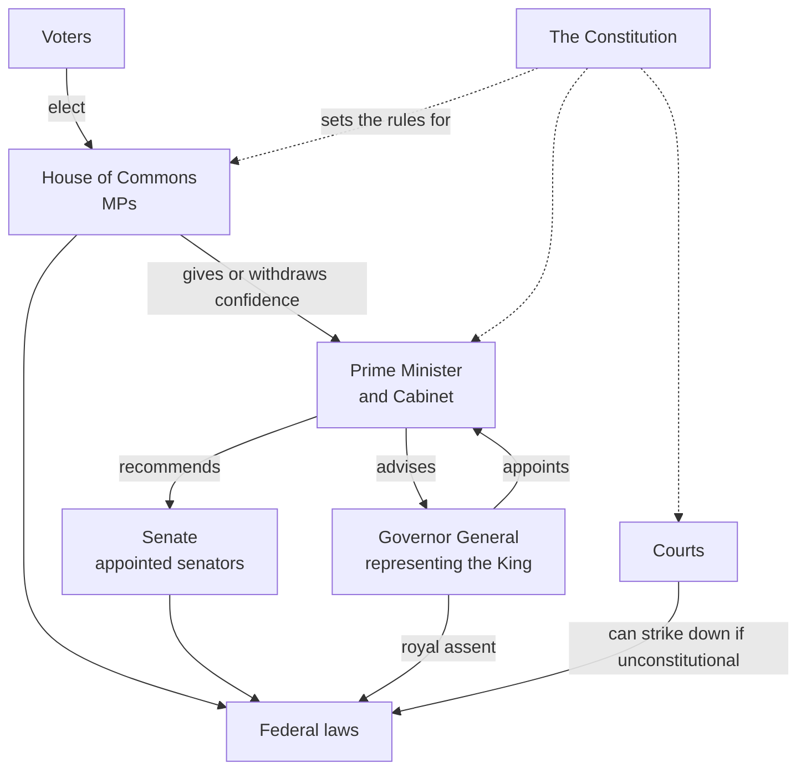

## TL;DR

Canada is a **federal parliamentary democracy** and a **constitutional monarchy**. The
King is head of state, but elected politicians do the actual governing in his name.
Voters elect a member of Parliament for their area. Whoever can win the support of the
House of Commons, usually the leader of the biggest party, becomes Prime Minister.
Power is split between the federal government and the provinces. A written
Constitution, interpreted by independent courts, sets the rules for all of them.

## Core

### The sentence, one idea at a time

**Constitutional monarchy.** Canada has a King. Charles III has been King of Canada
since 2022. The Constitution says the government's executive authority belongs to the
monarch. But by long-standing *convention* (an unwritten rule everyone follows), the
King and his representative, the Governor General, act only on the advice of elected
ministers. The Crown is where legal authority comes from. Elected politicians are the
ones who make the decisions.

**Parliamentary democracy.** Canada uses the British-style "Westminster" system. You
don't vote for a leader. You vote for one **member of Parliament (MP)** to represent
your **riding** (electoral district). After an election, the party that can command the
**confidence** of the House of Commons forms the government, and its leader becomes
Prime Minister. The Prime Minister and cabinet ministers are almost always MPs
themselves. They sit in the House and must answer to it every day. If the government
loses a confidence vote, it falls.

**Federal.** Canada has two orders of government, and the Constitution gives each its
own list of powers:

- **Federal:** things like national defence, criminal law, currency and citizenship.
- **Provincial:** things like hospitals, schools, and property and civil rights.

Within its own areas, neither one is the other's boss. The three **territories** work
differently: their powers are handed to them by the federal Parliament. **Cities and
towns** are created by their province.

### Who's who

| Role | Who | What they actually do |
|---|---|---|
| Head of state | The King | The legal source of authority and a national symbol |
| The King's representative | Governor General (federal); Lieutenant Governors (provinces) | Sign bills into law, appoint the Prime Minister, open and dissolve Parliament. By convention they do this on the elected government's advice. |
| Head of government | Prime Minister | Leads the government, chooses cabinet, sets direction |
| Lawmakers | Parliament: the King, the Senate (appointed) and the House of Commons (elected) | Pass laws, approve spending, hold the government to account |
| Judges | The courts, with the Supreme Court of Canada at the top | Interpret laws and the Constitution, and can strike down laws that break it |
| The public service | Departments and agencies | Non-partisan staff who carry out the government's decisions |

### How the pieces connect

### Three branches, blended

Like most democracies, Canada has three branches of government: **legislative**
(Parliament makes laws), **executive** (the government carries them out) and
**judicial** (the courts interpret them).

Unlike the United States, the first two are fused. The executive sits inside the
legislature and survives only as long as the House supports it. The sharp line in
Canada is the one around the **courts**, which are independent of both.

### The rulebook

The **Constitution** is the supreme law. Any law that conflicts with it has no force.
It isn't one document:

- **The Constitution Act, 1867** created the country and Parliament, and divided powers
  between Ottawa and the provinces.
- **The Constitution Act, 1982** added the **Canadian Charter of Rights and Freedoms**,
  recognized Aboriginal and treaty rights, and set out how the Constitution can be
  amended.
- **Unwritten conventions** fill in the rest. For example, the Prime Minister's job is
  barely mentioned in the written Constitution. Almost everything about it comes from
  convention.

### Levels of government

| Level | Examples of what it handles |
|---|---|
| Federal | Defence, criminal law, currency, immigration (shared), Indigenous relations |
| Provincial / territorial | Health care, education, highways, natural resources |
| Municipal | Local roads, transit, water, policing (often), zoning |
| Indigenous governments | Varies by nation; set by treaties and self-government agreements |

### Where to go next

- [The Constitution](/learn/constitution): the rulebook, written and unwritten
- [The Crown](/learn/crown): what the King and Governor General actually do
- [Parliament](/learn/parliament): the King, Senate and House of Commons, and how laws get made
- [Elections and the Prime Minister](/learn/elections): ridings, parties, and how the PM gets the job
- [Federalism](/learn/federalism): who does what, and who pays
- [Government in action](/learn/government): departments, Crown corporations, the Bank of Canada
- [The legal system](/learn/law): courts, common law and civil law
- [Rights: the Charter](/learn/charter): what's protected, and the limits
- [Indigenous peoples and the Crown](/learn/indigenous): treaties and constitutional rights

## Misconceptions

**"Canadians vote for the Prime Minister."**
No. You vote only for your local MP. The Prime Minister is whoever can hold the
confidence of the House of Commons, which is normally the leader of the party with the
most seats.

**"Canada isn't tied to the monarchy anymore."**
It still is. Charles III is King of Canada, a title legally separate from his British
one. His role is almost entirely ceremonial, but the whole legal system is built around
the Crown.

**"The Royal Canadian Mint is Canada's version of the Fed."**
The **Bank of Canada** is the central bank. It sets interest rates and issues
banknotes. The Mint makes coins.

**"Ottawa is in charge of the provinces."**
Not within provincial areas. The Constitution gives each order of government its own
powers. Provinces aren't branch offices of the federal government. Cities, on the other
hand, *are* created by their provinces.

**"The Constitution spells out how the government works."**
Only partly. The Prime Minister, cabinet and the rule that a government needs the
House's confidence mostly come from unwritten convention, not written text.

## Sources

- [Constitution Act, 1867](https://laws-lois.justice.gc.ca/eng/const/page-1.html): s. 9 (executive power vested in the Crown), s. 17 (Parliament is the King, Senate and House of Commons), ss. 91–92 (division of powers)
- [Constitution Act, 1982, including the Charter](https://laws-lois.justice.gc.ca/eng/const/page-12.html): s. 35 (Aboriginal and treaty rights)
- [The Constitution Acts, 1867 to 1982: table of contents](https://laws-lois.justice.gc.ca/eng/const/): s. 52 (Constitution is the supreme law)
- [The Crown in Canada](https://www.canada.ca/en/canadian-heritage/services/crown-canada.html) (Canadian Heritage)
- [Role and responsibilities of the Governor General](https://www.gg.ca/en/governor-general/role-and-responsibilities)
- [Discover Canada](https://www.canada.ca/en/immigration-refugees-citizenship/corporate/publications-manuals/discover-canada.html), the official citizenship study guide
- [About Canada's System of Justice](https://www.justice.gc.ca/eng/csj-sjc/just/index.html) (Department of Justice)
- [About the Bank of Canada](https://www.bankofcanada.ca/about/)
