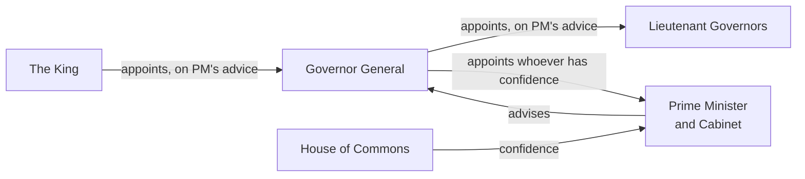

## TL;DR

Canada is a **constitutional monarchy**. The **King of Canada** is head of state, and
the Constitution places executive power in the Crown. In practice the King "reigns but
does not rule". His representatives, the **Governor General** federally and a
**Lieutenant Governor** in each province, sign bills into law, appoint the Prime
Minister and premiers, and open and dissolve legislatures. By convention, they do all
this on the advice of elected ministers. They keep a few **reserve powers** for genuine
emergencies, such as when it's unclear who has the confidence of the House. Ending the
monarchy would take the unanimous agreement of Parliament and all ten provinces.

## Core

### What "the Crown" means

**The Crown** is the legal term for the state's executive authority, personified in
the monarch. When you see "the Crown" in Canadian law, it usually means "the
government" in its legal capacity. That's why:

- Criminal cases are named *R. v. Smith*. "[R](term:r-crown)" stands for *Rex* or *Regina*, Latin for
  King or Queen. The Crown prosecutes crimes.
- Public land is called **[Crown land](term:crown-land)**, and government-owned companies are **Crown
  corporations** (see [Crown corporations](/learn/government/crown-corporations)).
- Government lawyers are **Crown counsel** or **Crown prosecutors**.

### The King of Canada

The King of Canada is the same person as the King of the United Kingdom, but the two
roles are legally separate. Canada's monarch acts on Canadian advice for Canadian
matters. Since 1953, the monarch's Canadian title has included "Queen" or "King of
Canada".

> **As of 2026:** {{monarch.name}} is King of Canada. He became King on the death of
> Elizabeth II in September 2022 and was crowned in May 2023.
<!-- check: the rest of this note (accession, coronation, "He") is about Charles III; rewrite it if monarch.name changes -->

The written Constitution puts the Crown at the centre:

- Executive government is "vested in the Queen" (now King) (Constitution Act, 1867,
  [s. 9](doc:constitution-act-1867/s9)).
- The monarch is commander-in-chief of the armed forces (s. 15).
- Parliament is made up of the King, the Senate and the House of Commons (s. 17).

### One Crown, many jurisdictions

Canada's Crown is **divisible**. The same monarch is the Crown "in right of Canada" for
federal matters and the Crown "in right of" each province for provincial matters. So
Ontario's government acts in the King's name just as the federal government does, and
each has its own representative.

| Jurisdiction | King's representative | Appointed by | On whose advice |
|---|---|---|---|
| Canada | [Governor General](org:governor-general) | The King | The Prime Minister |
| Each province | [Lieutenant Governor](org:lieutenant-governor) | The Governor General (on federal cabinet advice) | The Prime Minister |
| Each territory | Commissioner (a federal official, not a representative of the King) <!-- check: Commissioners' formal status --> | The federal government | Federal cabinet |

Both Governors General and Lieutenant Governors usually serve about five years. More in
[The Governor General and Lieutenant Governors](/learn/crown/governor-general).

### What the Crown does in practice

The Governor General (and, provincially, the Lieutenant Governor):

1. **Makes sure there's always a government.** After an election or a resignation,
   they appoint as Prime Minister the person who can command the confidence of the
   House.
2. **Summons, prorogues and dissolves Parliament.** Summoning starts Parliament.
   Proroguing ends a session. Dissolving ends a Parliament and triggers an election.
3. **Reads the [Speech from the Throne](term:speech-from-the-throne)**, written by the government, to open each
   session.
4. **Gives [royal assent](term:royal-assent)** to bills, the final step before they become law ([s. 55](doc:constitution-act-1867/s55)).
5. **Signs orders-in-council** and other official documents into effect.
6. **Swears in** the Prime Minister, ministers and the Chief Justice, and appoints
   judges, senators and Lieutenant Governors on the Prime Minister's advice.

Beyond that, the role is ceremonial and symbolic: honours and awards, state visits, and
representing Canada at home and abroad.

### "Reigns but does not rule"

Almost every one of those powers is exercised on the **advice** of the Prime Minister
or cabinet. This rests on [constitutional conventions](/learn/constitution/conventions),
not written law. The Governor General still has, in a classic British phrase, "the right
to be consulted, to encourage and to warn" (the Governor General's own website puts it
as "to advise, encourage and warn").

The exception is the **[reserve powers](term:reserve-powers)**: a small set of decisions the Governor General
can make on their own judgment, in rare situations where following advice would
undermine [responsible government](term:responsible-government). Examples are refusing a request to dissolve
Parliament when another party could govern, or appointing a Prime Minister when an
election is unclear. Only a handful of real cases exist in Canada. See
[Reserve powers](/learn/crown/reserve-powers).

### The Crown and Indigenous peoples

Treaties between First Nations and the Crown were made with the monarch, not with any
particular government. Courts describe a duty called the **[honour of the Crown](term:honour-of-the-crown)**:
governments must deal honourably with Indigenous peoples, including in treaty-making
and consultation. This is one reason the Crown is more than a symbol. See
[Indigenous peoples and the Crown](/learn/indigenous).

### Oaths

MPs and senators swear allegiance to the King before taking their seats (Constitution
Act, 1867, s. 128). New citizens swear or affirm allegiance to the King in the
citizenship oath. Quebec passed a law in 2022 making its own oath, which doesn't mention
the King, the only one required to sit in its National Assembly.

### Is it controversial?

The monarchy is a live debate. Supporters point to stability, a non-partisan head of
state above politics, and links to history, the Commonwealth and the treaties.
Critics argue that a hereditary, foreign-resident head of state doesn't fit a modern,
diverse democracy. Changing it is very hard. See
[Could Canada drop the monarchy?](/learn/crown/republic-question).

## Misconceptions

**"The Governor General is the head of state."**
The King is head of state. The Governor General represents him and exercises almost
all his powers in Canada, which is why the line can seem blurry.

**"The British government has a say in how Canada is run."**
No. The King acts on the advice of Canadian ministers for Canada. The British
government has no role. This has been clear since the 1920s and 1930s.

**"Royal assent is a formality the Governor General could refuse whenever they
like."**
Legally the power exists, but by convention assent is always given to bills passed by
both Houses. Refusing would be a constitutional crisis.

**"Lieutenant Governors work for the Governor General."**
They're appointed by the Governor General on the Prime Minister's advice, but each
represents the King directly in their own province. They don't report to the Governor
General.

**"The King has no real role, so the monarchy could be dropped by a simple vote."**
The Crown is woven through the Constitution. Changing "the office of the Queen" needs
Parliament plus all ten provincial legislatures (Constitution Act, 1982, [s. 41(a)](doc:constitution-act-1982/s41)).

## Sources

- [The Crown in Canada](https://www.canada.ca/en/canadian-heritage/services/crown-canada.html) (Canadian Heritage)
- [The Monarch](https://www.canada.ca/en/canadian-heritage/services/crown-canada/monarch.html) (Canadian Heritage): separate Canadian title since 1953
- [The Governor General](https://www.canada.ca/en/canadian-heritage/services/crown-canada/governor-general.html) and [The Lieutenant Governors](https://www.canada.ca/en/canadian-heritage/services/crown-canada/lieutenant-governors.html) (Canadian Heritage): appointment and term
- [Role and responsibilities of the Governor General](https://www.gg.ca/en/governor-general/role-and-responsibilities) and [Constitutional duties](https://www.gg.ca/en/governor-general/role-and-responsibilities/constitutional-duties)
- [Constitution Act, 1867](https://laws-lois.justice.gc.ca/eng/const/page-1.html): s. 9 (executive power), s. 10 (Governor General), s. 15 (command of the armed forces), s. 17 (Parliament)
- [Constitution Act, 1867, ss. 53–90](https://laws-lois.justice.gc.ca/eng/const/page-2.html): s. 55 (royal assent), s. 58 (Lieutenant Governors)
- [Constitution Act, 1867, s. 128](https://laws-lois.justice.gc.ca/eng/const/page-4.html) (oath of allegiance)
- [Constitution Act, 1982, Part V](https://laws-lois.justice.gc.ca/eng/const/page-13.html): s. 41(a)
- [Endnotes to the Constitution Acts](https://laws-lois.justice.gc.ca/eng/const/endNotes.html): Quebec's 2022 oath law (S.Q. 2022, c. 30)
