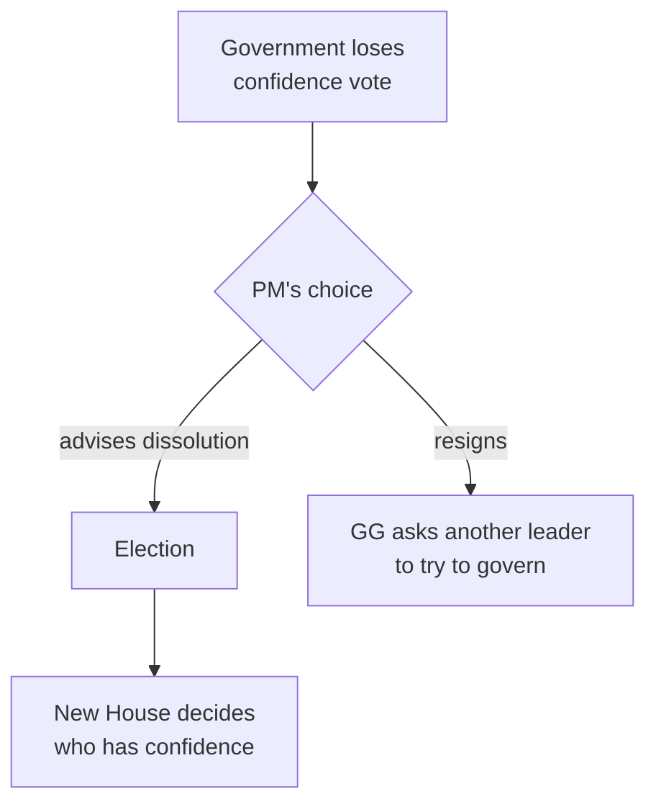

## In short

In Canada, a government doesn't serve a fixed term. It governs only as long as it has the
**confidence** of the [House of Commons](org:house-of-commons), meaning a majority of MPs are willing to back it on
key votes. A **majority government** has enough of its own MPs to guarantee that. A
**minority government** needs help from other parties. If a government loses a confidence
vote, the Prime Minister is expected to resign or ask for an election.

## The details

### A rule nobody wrote down

The confidence rule isn't in the Constitution Acts or any statute. It's a **[convention](term:convention)**: an
unwritten rule that politicians and the Governor General treat as binding. It's the heart of
"[responsible government](term:responsible-government)," the idea that the executive is responsible to the elected House.
See [conventions](/learn/constitution/conventions).

### Majority vs minority

> **As of 2026:** The House has {{commons.seats}} seats, so a majority means at least {{commons.majority}}.

<tn-widget name="commons-seating"></tn-widget>

| | Majority government | Minority government |
|---|---|---|
| Seats held by the governing party | More than half | Less than half |
| Can it pass bills alone? | Yes, if its MPs vote together | No, it needs votes from another party |
| Risk of losing a confidence vote | Very low | Real |
| How long it usually lasts | Often close to four years | Often shorter |

In a minority Parliament, the governing party can get support in a few ways:

- **Vote by vote:** it negotiates with different parties for each bill.
- **A formal agreement:** another party promises to support the government on confidence
  votes in exchange for policy commitments, while staying outside cabinet. This is sometimes
  called a **confidence-and-supply agreement**. One such agreement federally ran from 2022
  until 2024.
- **A [coalition](term:coalition):** two or more parties share cabinet seats. Coalitions are common in many
  countries but have been very rare at the federal level in Canada. <!-- check: confirm framing; the only federal coalition usually cited is the 1917 Union Government -->

### What counts as a confidence vote

It isn't always obvious, but these are generally treated as confidence votes:

- a motion that says outright that the House has, or doesn't have, confidence in the
  government;
- votes on the **[budget](term:budget)** and on **supply** (approving government spending);
- the vote on the **Speech from the Throne** at the start of a session;
- any vote the government itself declares to be a matter of confidence.

Losing an ordinary vote on some other bill doesn't automatically bring down a government.

### What happens if the government loses

The Prime Minister has two options, by convention:

1. **Resign.** The [Governor General](org:governor-general) then asks someone else, normally the [Leader of the
   Opposition](term:leader-of-the-opposition), to try to form a government that can win the House's confidence.
2. **Ask for [dissolution](term:dissolution).** The Governor General dissolves Parliament and an election
   follows. This is what almost always happens in practice.

Whether the Governor General could ever refuse a request for an election, and give another
party the chance to govern instead, is a question about the Crown's
[reserve powers](/learn/crown/reserve-powers). It last became a real issue federally in [1926](event:king-byng-affair).

### Examples

| Year | What happened |
|---|---|
| 1979 | A minority government lost a vote on its budget and an election followed. |
| 2005 | A minority government was defeated on an opposition non-confidence motion. |
| 2008 | Opposition parties announced a plan to defeat the government and replace it with a coalition. Parliament was [prorogued](event:prorogation-2008) before the vote could happen. See [reserve powers](/learn/crown/reserve-powers). |
| 2011 | A minority government was defeated on a motion finding it in contempt of Parliament, and an election followed. |

### After an election

The confidence rule also decides who governs after an election. The Prime Minister in office
before the election stays Prime Minister until they resign or lose the House's confidence.
If no party wins a majority, that Prime Minister has the right, by convention, to meet the
new House and test whether it will support them. In practice, if another party has clearly
won more seats, the outgoing Prime Minister usually resigns rather than wait. See
[elections](/learn/elections).

## Sources

- [Our Procedure: The Canadian Parliamentary System](https://www.ourcommons.ca/procedure/our-procedure/ParliamentaryFramework/c_g_parliamentaryframework-e.html) (the confidence convention and what counts as a confidence vote)
- [Our Procedure: Parliamentary Cycle](https://www.ourcommons.ca/procedure/our-procedure/ParliamentaryCycle/c_g_parliamentarycycle-e.html)
- [Role and responsibilities of the Governor General](https://www.gg.ca/en/governor-general/role-and-responsibilities)
- [The Crown in Canada](https://www.canada.ca/en/canadian-heritage/services/crown-canada.html) (Canadian Heritage)
