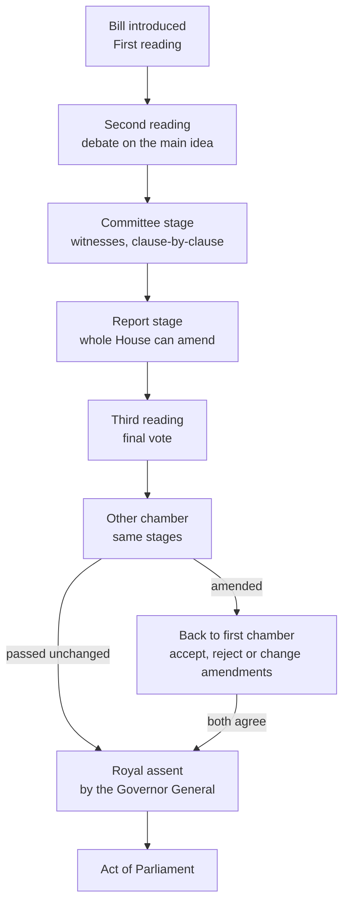

## In short

A **bill** is a proposed law. To become an **Act of Parliament**, it has to pass the [House
of Commons](org:house-of-commons) and the [Senate](org:senate) in exactly the same words, and then receive **royal assent**. In
each chamber it goes through three **readings** (stages of debate and voting), with a
detailed study by a **committee** in the middle. Most bills that become law are introduced
by the government.

## The details

### Who can introduce a bill

| Kind of bill | Introduced by | Example | Numbered |
|---|---|---|---|
| **Government bill** | A minister | A new criminal offence, a budget measure | C-2 to C-200 (House) or S-1 to S-200 (Senate) |
| **Private member's bill** | An MP who isn't a minister | A national awareness day, a targeted change to one law | C-201 to C-1000 |
| **Senate public bill** | A senator | Same range of topics, but no taxing or spending | S-201 to S-1000 |
| **Private bill** | A member, on behalf of a person or organization | Special powers or exemptions for one company | C-1001 or S-1001 onward; rare today |

Government bills and private members' bills are both **[public bills](term:public-bill)**, because they apply to
everyone. A **private bill** is different: it benefits a specific person or organization.

Two limits apply to everyone:

- Bills that raise taxes or spend public money must start in the **House of Commons**
  (Constitution Act, 1867, [s. 53](doc:constitution-act-1867/s53)).
- New spending needs a **[royal recommendation](term:royal-recommendation)**, which only the government can provide
  (s. 54). A private member can introduce a bill that spends money, but a minister must
  supply the recommendation before the final vote, or the bill can't pass.

### The stages

Most bills start in the House of Commons, but a bill can start in either chamber. The steps
are the same in each.

<tn-widget name="bill-steps"></tn-widget>

1. **First reading.** The bill is introduced and printed. There's no debate and no real
   vote. It's now public.
2. **Second reading.** MPs debate the bill's **principle**: is this a good idea at all? They
   can't change the wording at this stage. If the vote passes, the bill goes to committee.
3. **Committee stage.** A small group of MPs studies the bill in detail. They usually hear
   from **witnesses** (experts, officials, affected groups), then go through it
   **clause by clause**, voting on amendments. The committee then reports the bill back to
   the House.
4. **Report stage.** The whole House can propose further amendments. The Speaker decides
   which ones get debated.
5. **Third reading.** A final debate and vote on the bill in its finished form. If it
   passes, it goes to the other chamber.
6. **The other chamber.** The Senate (or the House, for a Senate bill) repeats the process.
   If it amends the bill, the bill goes back to the first chamber, which can accept, reject
   or modify the changes. Messages can go back and forth until both chambers agree on the
   same text, a process sometimes called "ping-pong."
7. **Royal assent.** The [Governor General](org:governor-general) (or a deputy) gives assent in the King's name.
   This can happen at a traditional ceremony in the Senate chamber or by **[written
   declaration](term:written-declaration)**. By convention, assent is never refused for a bill both chambers have
   passed.

Once it has royal assent, the bill is an **Act**. It takes effect that day unless it says
otherwise. Many Acts come into force on a later date, or on a date chosen by the cabinet.

### Shortcuts and variations

- **Committee before second reading.** The government can send a bill to committee right
  after first reading. This lets the committee make bigger changes, since the House hasn't
  yet approved the bill's principle.
- **[Pre-study](term:pre-study).** The Senate sometimes studies a bill's subject while it's still in the
  House, to speed things up later.
- **[Time allocation and closure](term:time-allocation-and-closure).** The government can use these procedures to limit how
  long debate lasts at a given stage. Opposition parties often object, but they're part of
  the House's rules.
- **Prorogation and dissolution.** When a session ends, bills that haven't passed usually
  die and must be reintroduced. Private members' bills in the House survive prorogation, but
  not an election.

### Why private members' bills rarely pass

Private members' bills get only a small share of the House's time: one hour a day. At the
start of each Parliament, a **random draw** sets the order in which MPs get to bring their
bills forward. Debate time is limited to a few hours per stage. Some do become law, but
most never reach a final vote.

### Where to follow a bill

Every bill's text and current stage is on **[LEGISinfo](term:legisinfo)**, run by Parliament. Search by number
(for example C-5) or keyword. Bill numbers restart each session, so the same number can mean
a different bill in a different Parliament.

## Sources

- [Our Procedure: The Legislative Process](https://www.ourcommons.ca/procedure/our-procedure/LegislativeProcess/c_g_legislativeprocess-e.html) (House of Commons)
- [Our Procedure: Private Members' Business](https://www.ourcommons.ca/procedure/our-procedure/PrivateMembersBusiness/c_g_privatemembersbusiness-e.html) (draw, time limits, royal recommendation)
- [House of Commons Procedure and Practice, ch. 16: The Legislative Process](https://www.ourcommons.ca/procedure/procedure-and-practice-3/ch_16_4-e.html) (bill numbering, written declarations)
- [House of Commons Procedure and Practice, 4th ed., ch. 16](https://www.ourcommons.ca/procedure-and-practice-4/ch16-5-e.html) (Senate pre-study under the Rules of the Senate; royal assent)
- [Constitution Act, 1867](https://laws-lois.justice.gc.ca/eng/const/page-1.html): s. 53 (money bills start in the Commons), s. 54 (royal recommendation), s. 55 (royal assent)
- [LEGISinfo](https://www.parl.ca/legisinfo/en/index)
