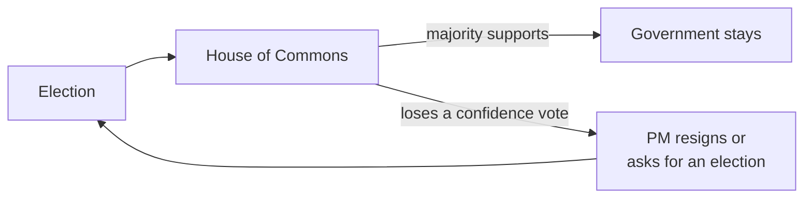

## TL;DR

**Parliament** is Canada's federal law-making body, and it has three parts: the **King**
(represented by the Governor General), the appointed **Senate** and the elected **House of
Commons**. A proposed law, called a **bill**, has to pass both the House and the Senate in
the same words and then receive **royal assent** before it becomes law. The House is the
more powerful chamber. The government is formed from it and stays in office only while a
majority of its members support it, which is called having the **confidence** of the
House. The Senate mainly reviews and improves bills. Its members are appointed, not
elected, so it rarely blocks what the elected House wants.

## Core

### Three parts, not two

People often say "Parliament" when they mean the House of Commons. Legally, though, the
Constitution says Parliament is made up of the King, the Senate and the House of Commons
(Constitution Act, 1867, s. 17). All three have to agree before a federal law exists.

| Part | Who | How they get there | What they mainly do |
|---|---|---|---|
| The King | Represented by the Governor General | Hereditary; the GG is appointed on the PM's advice | Gives royal assent to bills; opens and dissolves Parliament (by convention, on the government's advice) |
| Senate | Senators | Appointed by the Governor General on the Prime Minister's recommendation; serve to age 75 | Reviews bills, studies issues, represents regions and groups |
| House of Commons | Members of Parliament (MPs) | Elected, one per riding | Passes laws, approves taxes and spending, decides who governs |

> **As of 2026:** The House of Commons has 343 seats and the Senate has 105.

### What Parliament does

Parliament has three big jobs:

1. **Make laws.** Federal laws (on criminal law, immigration, banking and so on) start as
   bills. See [how a bill becomes law](/learn/parliament/how-a-bill-becomes-law).
2. **Control the money.** The government can't raise a tax or spend public money unless
   Parliament approves it. Bills to tax or spend must start in the House of Commons, and
   only the government can propose new spending (Constitution Act, 1867, ss. 53–54). See
   [the budget](/learn/government/the-budget).
3. **Hold the government to account.** Ministers sit in Parliament and have to answer
   questions there every day. See
   [Question Period and committees](/learn/parliament/question-period-and-committees).

### The government lives inside Parliament

This is the part that surprises people used to the US system. In Canada, the **government**
(the Prime Minister and cabinet) isn't a separate branch elected on its own. The Prime
Minister and almost all ministers are MPs, sitting in the House alongside everyone else.

The government stays in office only while it has the **confidence** of the House, meaning a
majority of MPs are willing to support it on key votes. This rule is a constitutional
**convention**: an unwritten rule that everyone follows. If the government loses a
confidence vote, the Prime Minister is expected to resign or ask the Governor General to
call an election.

### Majority and minority

- **Majority government:** the governing party holds more than half the seats. As long as
  its MPs vote together, it can pass its bills and survive any confidence vote.
- **Minority government:** the governing party has the most seats, or at least enough
  support to govern, but less than half. It needs votes from at least one other party to
  pass bills and stay in office.

Canada has had many minority governments. They tend to be shorter, and they make
confidence votes a real event rather than a formality. See
[majority, minority and confidence](/learn/parliament/confidence).

### Government, Opposition and the Speaker

- **The government side:** the governing party's MPs, led by the Prime Minister.
- **The Official Opposition:** by convention, the party with the second-most seats. Its
  leader becomes **Leader of the Opposition** and asks the first questions in Question
  Period.
- **Other parties:** a party needs at least 12 MPs to be a **recognized party** in the House,
  which brings extra funding and speaking rights.
- **The Speaker:** an MP elected by all the other MPs to run debates neutrally. The Speaker
  doesn't take sides and votes only to break a tie.

### Party discipline

Canadian MPs usually vote with their party. Party leaders use **whips** (MPs whose job is to
organize and count votes) to keep members in line. On a confidence vote, voting against your
own party can bring down your own government, so discipline is especially tight. Parties
sometimes allow a **free vote**, where MPs vote as they personally choose, usually on
moral questions.

### The Senate in one paragraph

The Senate is the "upper house." Its 105 senators are appointed, not elected, and seats are
divided by region rather than by population. It can amend or reject any bill, but because
it isn't elected, by convention it usually gives way to the House. Since 2016, senators have
been recommended through an independent advisory process, and most no longer sit as party
members. See [the Senate](/learn/parliament/senate).

### A Parliament has a lifespan

A **Parliament** (as in "the 45th Parliament") runs from one election to the next. It is
divided into **sessions**:

- A session opens with a **Speech from the Throne**, read by the Governor General, setting out
  the government's plans.
- **Prorogation** ends a session without an election. Most bills that haven't passed die
  and have to start over.
- **Dissolution** ends the whole Parliament, and an election follows.

The Charter limits a House of Commons to five years from the return of the writs after an
election (Charter, s. 4), but elections usually come sooner. See
[elections](/learn/elections). For how the Governor General's role in prorogation and
dissolution has been tested, see [reserve powers](/learn/crown/reserve-powers).

### Provinces have their own legislatures

Each province has its own elected legislature, usually called a **Legislative Assembly**
(Quebec's is the **National Assembly**). Provincial legislatures have only one chamber; no
province has a senate. They work much like the House of Commons, with a premier who must
keep the legislature's confidence. See [the provinces](/provinces).

## Misconceptions

**"Parliament means the House of Commons."**
Parliament is the King, the Senate and the House of Commons together. All three must agree
to make a federal law.

**"The Senate is just a rubber stamp."**
Senators regularly amend bills, and the House often accepts those changes. Outright defeat
of a bill passed by the House is rare, but it has happened.

**"The government and Parliament are the same thing."**
The government (PM and cabinet) sits *in* Parliament but is not the same as it. Parliament
includes opposition MPs and senators, and can vote the government out.

**"MPs can vote however they like."**
Formally, yes. In practice, party discipline is strong in Canada, and MPs rarely vote
against their party on important votes.

**"A minority government is illegitimate or temporary by nature."**
A minority government has exactly the same legal powers as a majority. It just needs
support from other parties to pass bills and survive confidence votes.

## Sources

- [Constitution Act, 1867](https://laws-lois.justice.gc.ca/eng/const/page-1.html): s. 17 (Parliament is the King, Senate and House of Commons), s. 21 (105 senators), ss. 53–54 (money bills and royal recommendation), s. 55 (royal assent)
- [Constitution Act, 1982 / Charter](https://laws-lois.justice.gc.ca/eng/const/page-12.html): s. 4 (maximum five-year House)
- [House of Commons: "Our Procedure"](https://www.ourcommons.ca/procedure/our-procedure/)
- [Our Procedure: The Canadian Parliamentary System](https://www.ourcommons.ca/procedure/our-procedure/ParliamentaryFramework/c_g_parliamentaryframework-e.html) (confidence, Official Opposition, recognized parties)
- [Our Procedure: Parliamentary Cycle](https://www.ourcommons.ca/procedure/our-procedure/ParliamentaryCycle/c_g_parliamentarycycle-e.html) (sessions, prorogation, dissolution)
- [Senate of Canada: About](https://sencanada.ca/en/about/)
- [LEGISinfo](https://www.parl.ca/legisinfo/en/index): track any bill in Parliament
