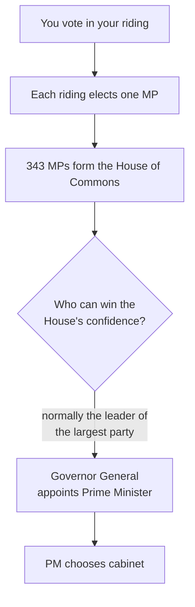

## TL;DR

In a federal election, Canada is divided into **ridings** (electoral districts), and each
riding elects one **member of Parliament (MP)**. Whoever gets the most votes in a riding
wins it, even without a majority. This system is called **first-past-the-post**. You never
vote directly for the Prime Minister. The Prime Minister is whoever can win and keep the
**confidence** of the House of Commons, which in practice is normally the leader of the
party with the most seats. Party leaders are chosen by their party's members, not by
voters at large. The Prime Minister then picks a **cabinet** of ministers, almost always
from among the MPs.

## Core

### What you're actually voting for

Your ballot lists the candidates running in **your riding** only. You mark one name. That's
it. There's no separate vote for Prime Minister and no national vote for parties.

> **As of 2026:** There are 343 ridings, so 343 MPs.

To see every riding and who won it in 2025, or to find your own, use the
[ridings map](/ridings).

Most candidates run for a **political party**, and their party appears on the ballot next to
their name. Many voters choose based on the party or its leader more than the local
candidate. Legally, though, you're electing one person to represent your area.
**Independent** candidates, who belong to no party, can run too.

### Who can vote

To vote in a federal election you must be:

- a **Canadian citizen**, and
- at least **18** on election day.

The Charter guarantees every citizen the right to vote (s. 3). You also need to be registered
and prove who you are and where you live. See [how a federal election runs](/learn/elections/election-day).

### Who runs elections

**Elections Canada** is an independent, non-partisan agency led by the **Chief Electoral
Officer**. It reports to Parliament, not to the government of the day. It runs elections,
registers voters, enforces election finance rules and educates the public.

### From votes to seats

Each riding's result is decided separately. The candidate with the most votes wins the
riding, whether that's 60% or 32% of the vote. See
[first-past-the-post](/learn/elections/first-past-the-post).

Because of this, a party's share of **seats** can be quite different from its share of the
national **vote**. A party with under 40% of the vote can win more than half the seats. A
party with broad but thin support everywhere can win very few seats.

### From seats to a Prime Minister

Here's the chain that turns an election into a government:

1. The results show how many seats each party won.
2. If one party has a **majority** (more than half the seats), its leader will clearly have
   the House's confidence.
3. If no party has a majority, the result is a **minority Parliament**. The party with the
   most seats usually governs, with support from other parties on key votes. See
   [majority, minority and confidence](/learn/parliament/confidence).
4. The **Governor General** appoints as Prime Minister the person most likely to have the
   House's confidence. By convention, this isn't a personal choice. It follows the election
   result.

<tn-widget name="election-to-government"></tn-widget>

Strictly speaking, Canada never stops having a Prime Minister. The sitting PM stays in office
through the election and either carries on or resigns so the winner can be sworn in.

### The Prime Minister

The Prime Minister is **head of government**. The office is barely mentioned in the written
Constitution. Almost everything about it comes from convention.

A few things that follow from this:

- **The PM doesn't need to win their own seat to become PM,** though by convention they're
  expected to get a seat in the House soon.
- **The PM can change without an election.** If a governing party picks a new leader, that
  person becomes Prime Minister. This has happened several times, most recently in 2025.
- **There's no term limit.** A PM can stay as long as they keep their party's leadership and
  the House's confidence, and keep winning elections.

### Parties and leaders

Parties choose their own leaders, usually through a vote of party members, under the party's
own rules. You can join a party and vote for its leader, but the general public doesn't get a
say. See [how parties choose leaders](/learn/elections/party-leaders).

### Cabinet

The Prime Minister chooses **ministers**, who each run a department or area of policy.
Together they form the **cabinet**, the main decision-making body of the government.
Ministers are almost always MPs from the governing party. Two key offices support the PM:
the political **Prime Minister's Office (PMO)** and the non-partisan **Privy Council Office
(PCO)**. See [cabinet, the PMO and the PCO](/learn/elections/cabinet-and-pmo).

### When elections happen

Since 2007, federal law has set a **fixed election date**: the third Monday in October of the
fourth calendar year after the last election. But the law also keeps the Governor General's power to
dissolve Parliament earlier, and several elections have been called before the fixed date.
See [how a federal election runs](/learn/elections/election-day). The Charter sets an outside
limit of five years (s. 4).

### Elections everywhere

Provinces and territories hold their own elections for their legislatures, run by their own
election agencies, under their own laws. Municipal elections are run under provincial rules.
Nunavut and the Northwest Territories elect members without political parties. See
[the provinces](/provinces).

## Misconceptions

**"I vote for the Prime Minister."**
You vote only for your local MP. The Prime Minister is whoever can hold the House's
confidence, normally the leader of the party with the most seats.

**"The party with the most votes wins."**
Seats, not votes, decide who governs. A party can win the most votes nationally and still win
fewer seats than another party. This happened federally in 2019 and 2021.

**"If the governing party changes leaders, there must be an election."**
No. The new party leader becomes Prime Minister and governs as long as they keep the House's
confidence.

**"Election dates are fixed by law, so they can't be early."**
The fixed-date law expressly keeps the Governor General's power to dissolve Parliament. Early
elections have been called several times since the law passed.

**"The winning party has to get more than 50% of the vote."**
No. In each riding, the candidate with the most votes wins, even without a majority. A party
can win a majority of seats with well under half the national vote.

## Sources

- [Canada Elections Act](https://laws-lois.justice.gc.ca/eng/acts/E-2.01/): s. 3 (who can vote), s. 56.1 (fixed election date)
- [Constitution Act, 1982 / Charter](https://laws-lois.justice.gc.ca/eng/const/page-12.html): s. 3 (right to vote), s. 4 (maximum five years)
- [Elections Canada: Our mission, mandate, values](https://www.elections.ca/content.aspx?section=abo&dir=mis&document=index&lang=e)
- [Elections Canada: Voting FAQ](https://www.elections.ca/content.aspx?section=vot&dir=faq&document=faqvoting&lang=e)
- [Our Procedure: The Canadian Parliamentary System](https://www.ourcommons.ca/procedure/our-procedure/ParliamentaryFramework/c_g_parliamentaryframework-e.html)
- [Role and responsibilities of the Governor General](https://www.gg.ca/en/governor-general/role-and-responsibilities)
- [Discover Canada](https://www.canada.ca/en/immigration-refugees-citizenship/corporate/publications-manuals/discover-canada.html), the official citizenship study guide
