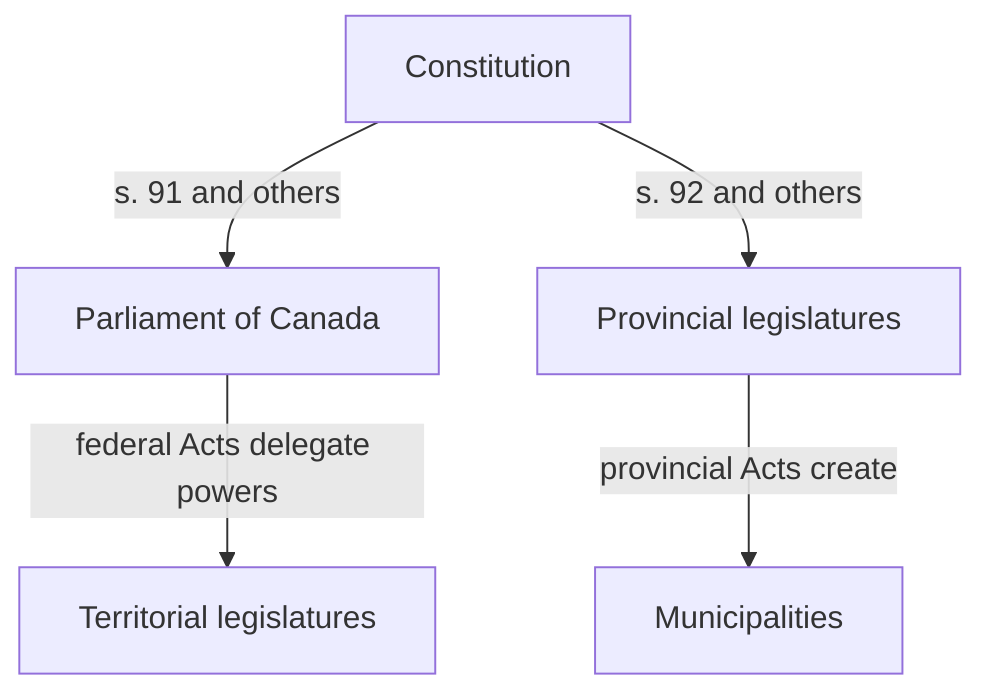

## TL;DR

Canada is a **federation**: the Constitution splits law-making power between the
**federal** Parliament in Ottawa and the ten **provincial** legislatures. Each has its
own list of subjects, mostly in sections 91 and 92 of the Constitution Act, 1867.
Ottawa handles things like defence, criminal law, currency and banking; the provinces
handle things like hospitals, schools, property and municipalities. Some areas are
shared, and the courts settle disputes. The three **territories** are different: their
powers are delegated by federal law. **Cities** are created by their province. Because
Ottawa raises more money than it needs for its own jobs, it sends large **transfers**
to the provinces and territories, including **equalization** for provinces with less
ability to raise revenue.

## Core

### Two orders of government, neither in charge of the other

A **federation** is a country where power is divided between a central government and
regional governments, and the division is protected by the constitution. Neither side
can take the other's powers away by passing an ordinary law.

In Canada, the two **orders of government** (the usual Canadian term, rather than
"levels", because neither is above the other) are:

- **Federal:** the Parliament of Canada and the federal government in Ottawa.
- **Provincial:** the legislature and government of each of the ten provinces.

Within its own areas, each is supreme. A province isn't a branch office of Ottawa, and
the Prime Minister can't give orders to a premier.

### Who does what

The **Constitution Act, 1867** sets out the main lists. **Section 91** lists federal
subjects and **section 92** lists provincial ones. A few other sections add to them.
The lists use 1867 wording, so courts have spent over 150 years working out what they
mean for things nobody imagined then, like aviation, radio and the internet.

| Mostly federal | Mostly provincial | Shared or contested |
|---|---|---|
| Defence and the military | Hospitals and health care delivery | Immigration (s. 95) |
| Criminal law | Education (s. 93) | Agriculture (s. 95) |
| Currency, banking, interest | Property and civil rights (contracts, most labour law, most business regulation) | Environment |
| Postal service | Municipalities | Pensions (s. 94A) |
| Citizenship ("naturalization") | Administration of justice (courts, policing) | Health (provinces deliver; Ottawa funds and sets conditions) |
| Indigenous peoples and reserve lands (s. 91(24)) | Natural resources (s. 92A) | Taxation (both can tax) |
| Trade between provinces and countries | Local matters generally | |

Anything not on either list belongs to Parliament under its general power to make laws
for the "Peace, Order, and good Government of Canada". See the full table, with section
numbers, in [the division of powers](/learn/federalism/division-of-powers).

### Shared and contested areas

Real life doesn't sort neatly into two lists. Three examples:

- **Health.** The Constitution never says "health". Provinces run hospitals and health
  insurance, because hospitals and most of health care fall under their powers. Ottawa
  is involved mostly through money: it pays the **Canada Health Transfer** on condition
  that provincial health insurance follows the **Canada Health Act**. It also regulates
  drugs and food safety, partly under its criminal law power.
- **Environment.** Also not mentioned in 1867. Both orders regulate it, each through its
  own powers: provinces through property and natural resources, Ottawa through
  fisheries, navigation, criminal law and, for greenhouse gases, its general power. In
  2021 the Supreme Court upheld federal minimum carbon pricing as a matter of "national
  concern".
- **Immigration.** Section 95 makes it **concurrent**: both orders can make laws on it,
  but federal law wins in a conflict. In practice Ottawa runs the system, while
  provinces nominate some economic immigrants. Quebec has its own agreement with Ottawa
  and selects most of its economic immigrants itself.

### When federal and provincial laws collide

Courts first ask whether each law is valid: does it fall within that government's
powers? Often both are valid, because the same activity can be regulated for different
reasons. Driving drunk can be a crime (federal) and also lead to a licence suspension
(provincial).

If both laws are valid but truly conflict, the rule of **federal paramountcy** applies:
the federal law wins, and the provincial law stops applying to the extent of the
conflict. Courts apply this narrowly and generally prefer to let both laws work side
by side.

### Territories and cities are different

- **Territories.** Yukon, the Northwest Territories and Nunavut have elected
  legislatures and premiers, and run many of the same services as provinces. But their
  powers come from federal laws, not the Constitution, so in principle Parliament could
  change them. More in [why territories aren't provinces](/learn/federalism/territories).
- **Municipalities.** Section 92(8) gives provinces power over "Municipal Institutions".
  Cities and towns exist because a provincial law created them, and the province can
  change their powers, merge them or redraw their councils. More in
  [municipalities](/learn/federalism/municipalities).

### Following the money

The federal government collects more tax revenue than it needs for its own
responsibilities, while provinces carry expensive jobs like health care and education.
Economists call this a **fiscal imbalance** or "vertical" gap. Ottawa closes some of it
with **transfers**:

- **Canada Health Transfer** and **Canada Social Transfer:** paid to every province and
  territory on an equal per-person basis.
- **Equalization:** paid only to provinces whose ability to raise revenue is below the
  national standard. The Constitution Act, 1982 (s. 36(2)) commits Ottawa to the
  principle.
- **Territorial Formula Financing:** the territories' version, reflecting the high cost
  of services in the North.

Details are in [transfers and equalization](/learn/federalism/money-and-equalization).

### Cooperation in practice

Much of federalism happens at meeting tables, not in courtrooms. First ministers (the
Prime Minister and premiers) and ministers in each field meet regularly to negotiate
funding deals and coordinate policy. The premiers also meet on their own through the
**Council of the Federation**, created in 2003.

Federalism also allows **asymmetry**: provinces can use the same powers differently.
Quebec, for example, uses civil law for private matters, runs its own pension plan (the
Quebec Pension Plan, rather than the Canada Pension Plan), and collects its own
personal income tax.

> **People disagree about this.** How "centralized" Canada should be is a long-running
> debate. Some argue Ottawa should set national standards in areas like health care,
> child care and the environment, using its spending power. Others argue Ottawa
> should respect provincial jurisdiction and transfer money or tax room with few strings
> attached. Quebec governments in particular have long defended provincial autonomy.

## Misconceptions

**"The provinces work for the federal government."**
No. Each order of government gets its powers directly from the Constitution. Within
their own areas, provinces are fully in charge, and Ottawa can't overrule them by
ordinary law.

**"Health care is run by the federal government."**
Provinces and territories run health care. Ottawa contributes money through the Canada
Health Transfer and attaches conditions through the Canada Health Act, but it doesn't
run hospitals or pay doctors.

**"Richer provinces send equalization payments to poorer ones."**
Equalization is paid by the federal government from its general revenues, which come
from taxpayers everywhere in Canada. No provincial government writes a cheque into the
program.

**"Territories are just small provinces."**
Provinces' powers are protected by the Constitution. Territories' powers are delegated
by federal laws. Turning a territory into a province would take a constitutional
amendment.

**"Cities have their own constitutional powers."**
They don't. Municipalities are created by provincial laws and can be reshaped by them,
as the Supreme Court confirmed in a 2021 case about Toronto's city council.

## Sources

- [Constitution Act, 1867, ss. 91–95](https://laws-lois.justice.gc.ca/eng/const/page-3.html): s. 91 (federal powers), s. 92 (provincial powers, including s. 92(8) municipal institutions), s. 92A (natural resources), s. 93 (education), s. 94A (pensions), s. 95 (agriculture and immigration)
- [Constitution Act, 1982, s. 36](https://laws-lois.justice.gc.ca/eng/const/page-13.html): equalization and regional disparities
- [Federal transfers to provinces and territories](https://www.canada.ca/en/department-finance/programs/federal-transfers.html) (Finance Canada)
- [Provinces and territories](https://www.canada.ca/en/intergovernmental-affairs/services/provinces-territories.html) (Intergovernmental Affairs)
- [References re Greenhouse Gas Pollution Pricing Act, 2021 SCC 11: Case in Brief](https://www.scc-csc.ca/judgments-jugements/cb/2021/38663-38781-39116/) (Supreme Court of Canada)
- [Toronto (City) v. Ontario (Attorney General), 2021 SCC 34: Case in Brief](https://www.scc-csc.ca/judgments-jugements/cb/2021/38921/) (Supreme Court of Canada)
