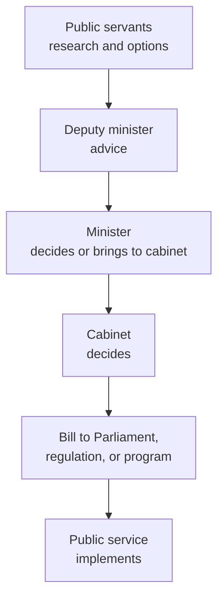

## In short

The federal government is organized into **departments**, each led politically by a
**minister** and administratively by a **deputy minister**. The people who work in them
are **public servants**, hired on merit and expected to serve whichever party is in
power, without taking sides. Ministers answer to Parliament for what their departments
do; public servants answer to their ministers.

## The details

### What a department is

A **department** is a part of the federal government responsible for a broad area of
policy, such as health, justice or national defence. Most are created by their own Act
of Parliament (for example the *Department of Finance Act*), which sets out what the
minister is responsible for. They're listed in Schedule I of the *Financial
Administration Act* and funded through money Parliament votes each year.

Alongside departments there are many other federal bodies, including:

- **Agencies and departmental corporations**, like the Canada Revenue Agency and
  Statistics Canada, which do specialized work under their own legislation.
- **[Crown corporations](term:crown-corporation)**, which run more like businesses. See
  [Crown corporations](/learn/government/crown-corporations).
- **Independent tribunals and regulators**, which make decisions at arm's length from
  ministers.

The Prime Minister decides how cabinet and the departments are organized: creating
portfolios, merging departments or moving responsibilities between them. This is
sometimes called the **machinery of government**.

### The minister

A **minister** is a member of [cabinet](org:cabinet), almost always an MP, appointed on the Prime
Minister's advice. The minister:

- sets the department's direction, within the government's overall agenda;
- takes key decisions that the law assigns to the minister;
- brings proposals to cabinet;
- answers for the department in Parliament, in Question Period and before committees.

The principle of **[ministerial responsibility](term:ministerial-responsibility)** means the minister is accountable to
Parliament for the department's actions, even ones they didn't know about.

### The deputy minister

The **deputy minister** is the department's most senior public servant. Deputy
ministers are appointed by the [Governor in Council](term:governor-in-council) on the recommendation of the Prime
Minister, not chosen by their own minister. They:

- manage the department's staff, budget and operations;
- give the minister professional, non-partisan advice, including advice the minister
  may not want to hear;
- make sure decisions are carried out lawfully.

Deputy ministers are also **accounting officers**: they can be called before
parliamentary committees to answer for how their department manages its money.

### The centre of government

A few organizations coordinate everyone else and are often called **central agencies**:

| Organization | Role |
|---|---|
| **[Privy Council Office (PCO)](org:pco)** | The Prime Minister's public service department. Supports cabinet and coordinates policy. Led by the **Clerk of the Privy Council**, who is also head of the public service. |
| **Treasury Board** and its **Secretariat (TBS)** | A cabinet committee (and the department supporting it) that acts as the government's management board: spending controls, the estimates, and rules for the public service as an employer. |
| **[Department of Finance](term:department-of-finance)** | Tax and economic policy, and the budget. |

The **[Prime Minister's Office (PMO)](org:pmo)** is different: it's made up of political staff, not
public servants. See [cabinet and the PMO](/learn/elections/cabinet-and-pmo).

### A non-partisan public service

Canada's public service follows the [Westminster](term:westminster-system) tradition of a **permanent,
non-partisan public service**:

- **Merit.** Under the *Public Service Employment Act*, appointments are based on merit
  and must be free from political influence. The **[Public Service Commission](term:public-service-commission)**, which
  reports to Parliament, oversees this.
- **Political activity limits.** Public servants can vote and, at lower levels, take
  part in some political activity. But they can't do anything that would impair, or
  look like it impairs, their ability to do their job in a politically neutral way.
  Running as a candidate requires the Public Service Commission's permission. Rules are
  stricter for deputy ministers, who aren't allowed to engage in political activity
  except voting.
- **Continuity.** When the government changes after an election, deputy ministers and
  public servants stay. They give the new ministers the same loyal service they gave
  the old ones.
- **Values and ethics.** A government-wide code sets out expected values: respect for
  democracy, respect for people, integrity, stewardship and excellence.
  <!-- check: Values and Ethics Code wording; unresolved 2026-11-13: blocked to automated fetch (tbs-sct.canada.ca rejects the request; canada.ca values-and-ethics pages return no text) -->

Ministers also employ **exempt staff** (political advisers, communications staff) who
are hired outside the merit system and leave with their minister.

### How a decision flows

Provinces and territories have the same basic model: ministers, deputy ministers and a
merit-based public service of their own.

## Sources

- [Overview of federal organizations and interests](https://www.canada.ca/en/treasury-board-secretariat/services/reporting-government-spending/inventory-government-organizations/overview-institutional-forms-definitions.html) (Treasury Board Secretariat): definitions of departments, departmental corporations and other institutional forms
- [Public Service Employment Act](https://laws-lois.justice.gc.ca/eng/acts/P-33.01/): s. 30 (basis of appointment), Part 7 (political activities: ss. 113, 114 and 117)
- [Open and Accountable Government](https://www.pm.gc.ca/en/news/backgrounders/2015/11/27/open-and-accountable-government) (Prime Minister of Canada, 2015): deputy ministers chosen by the Prime Minister on the Clerk's advice and appointed by the Governor in Council; accounting officers
- [Financial Administration Act](https://laws-lois.justice.gc.ca/eng/acts/F-11/): Schedule I (departments)
- [House of Commons: "Our Procedure"](https://www.ourcommons.ca/procedure/our-procedure/)
