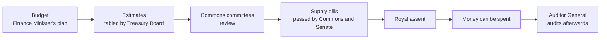

## TL;DR

The **government** in the everyday sense is the **executive**: the Prime Minister and
cabinet ministers, acting formally in the name of the King. Each minister is in charge
of one or more **departments**, staffed by a **public service** that's hired on merit
and stays in place whichever party wins. Some jobs are handed to **Crown corporations**
(like Canada Post and CBC/Radio-Canada) or to arm's-length agencies. The **Bank of
Canada** sets interest rates and issues banknotes; the **Royal Canadian Mint** just makes
coins. Independent **officers of Parliament**, such as the Auditor General, check the
government's work. And no money can be spent without Parliament's approval.

## Core

### The executive: who's in charge

Legally, executive power belongs to the King ([s. 9](doc:constitution-act-1867/s9) of the Constitution Act, 1867). In
practice it's used by the **[cabinet](org:cabinet)**: the Prime Minister and the ministers they choose,
almost all of them MPs. Formal decisions are made by the **[Governor in Council](term:governor-in-council)**,
meaning the Governor General acting on cabinet's advice. Many regulations and
appointments are made this way. See [cabinet and the PMO](/learn/elections/cabinet-and-pmo).

Two principles hold this together:

- **[Ministerial responsibility](term:ministerial-responsibility).** Each minister answers to Parliament for everything
  their department does, even decisions they didn't personally make. That's what
  Question Period is for.
- **[Cabinet solidarity](term:cabinet-solidarity).** Once cabinet decides something, every minister must publicly
  support it or resign.

### Ministers and departments

A **department** (for example Finance, Health, or Global Affairs) is the main unit of
the federal government. Each one has two leaders:

| | Minister | Deputy minister |
|---|---|---|
| Who | An elected politician (almost always) | A senior career public servant |
| Chosen by | The Prime Minister | Appointed by the Governor in Council on the Prime Minister's recommendation |
| Job | Sets direction, makes key decisions, answers to Parliament | Runs the department, gives frank advice, implements decisions |
| Changes after an election? | Yes, if the government changes | Not necessarily |

The top public servant in the country is the **[Clerk of the Privy Council](term:clerk-of-the-privy-council)**, who leads
the public service and serves as the Prime Minister's deputy minister and as secretary
to the cabinet. More in [departments and the public service](/learn/government/departments).

### A non-partisan public service

Federal public servants are hired on **merit**, not party loyalty, and the **[Public
Service Commission](term:public-service-commission)** protects that system. They are expected to serve the government of
the day loyally and give honest advice, whichever party is in power. Their political
activities are limited, especially for senior staff, so that the public service stays
neutral.

Ministers also have **political staff** (in their offices and in the Prime Minister's
Office). These aren't public servants: they're hired for their political loyalty and
leave when the minister does.

### Beyond departments: agencies and Crown corporations

Not everything is done by a department:

- **Agencies** such as the Canada Revenue Agency and Statistics Canada are part of the
  government but have their own specialized structure.
- **[Crown corporations](term:crown-corporation)** are companies wholly owned by the government, used when a job
  needs to be run in a businesslike way and kept at arm's length from day-to-day
  politics. Examples: Canada Post, CBC/Radio-Canada, VIA Rail, the Royal Canadian Mint.
  See [Crown corporations](/learn/government/crown-corporations).

Provinces have their own departments, public services and Crown corporations too, such
as provincial power utilities and liquor boards.

### Who controls money? Not the Mint

| | Bank of Canada | Royal Canadian Mint | Department of Finance |
|---|---|---|---|
| Is | The central bank | A Crown corporation that manufactures coins | A government department |
| Does | Sets the **policy interest rate**, keeps inflation low and stable, issues banknotes | Makes circulation coins, collector coins and bullion | Advises on taxes, spending and the economy; prepares the budget |
| Independence | Sets monetary policy independently within a target agreed with the government | Run at arm's length, reports through a minister | Under direct ministerial control |

The Bank of Canada is the equivalent of a central bank like the US Federal Reserve. The
Mint is a coin factory. See [the Bank of Canada vs. the Mint](/learn/government/bank-of-canada-vs-mint).

### The watchdogs

Parliament has created independent **[officers of Parliament](term:officers-of-parliament)** who report to Parliament
rather than to the government. The best known is the **[Auditor General](org:auditor-general)**, who audits
government spending and programs. Others include the **Parliamentary Budget Officer**,
the **Conflict of Interest and Ethics Commissioner**, the **Chief Electoral Officer**,
and the commissioners for privacy, access to information, official languages and
lobbying. See [officers of Parliament](/learn/government/watchdogs).

### How spending gets approved

Under the Constitution, the government can't tax or spend public money without
Parliament's approval, and only the government can propose spending:

The **budget** is the government's plan. The legal authority to spend comes from the
**[estimates](term:estimates)** and the **[supply (appropriation) bills](term:supply-bill)** that follow, plus spending
already authorized by other laws. More in [how federal spending gets approved](/learn/government/the-budget).

## Misconceptions

**"Public servants work for the party in power."**
They serve the government of the day, but they're hired on merit and are expected to be
non-partisan. When a new party takes over, the public service stays and serves it
just as loyally.

**"The Royal Canadian Mint controls Canada's money supply."**
The Mint only makes coins. The **Bank of Canada** sets interest rates, steers inflation
and issues banknotes.

**"The budget is the law that lets the government spend money."**
The budget is a plan and a political statement. Legal authority comes from Parliament
passing appropriation acts based on the estimates, and from other laws that authorize
specific spending.

**"Crown corporations are just government departments with a different name."**
They're separate companies with their own boards, run at arm's length. The government
sets their mandate and approves their plans but doesn't usually manage them day to day.

**"The Auditor General works for the government."**
The Auditor General is independent and reports to Parliament. Appointment needs
consultation with every recognized party and approval by both the House and the Senate.

## Sources

- [Constitution Act, 1867](https://laws-lois.justice.gc.ca/eng/const/page-1.html): s. 9 (executive power vested in the Crown); [ss. 53–54](https://laws-lois.justice.gc.ca/eng/const/page-2.html) (money bills and royal recommendation)
- [Overview of federal organizations and interests](https://www.canada.ca/en/treasury-board-secretariat/services/reporting-government-spending/inventory-government-organizations/overview-institutional-forms-definitions.html) (Treasury Board Secretariat): departments, Crown corporations, agents of Parliament
- [Public Service Employment Act](https://laws-lois.justice.gc.ca/eng/acts/P-33.01/): Part 7 (political activities)
- [About the Bank of Canada](https://www.bankofcanada.ca/about/)
- [Royal Canadian Mint: our company](https://www.mint.ca/en/company)
- [Auditor General Act](https://laws-lois.justice.gc.ca/eng/acts/A-17/): s. 3 (appointment and term)
