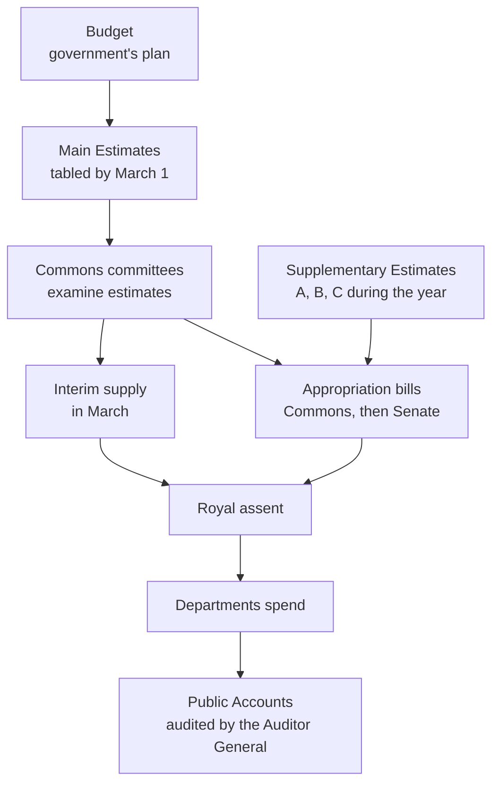

## In short

The **budget** is the government's economic and fiscal plan, presented by the Minister
of Finance. It isn't what makes spending legal. That comes from the **estimates**,
detailed spending requests tabled in Parliament, and the **supply bills** (appropriation
acts) that Parliament passes to approve them, along with other laws that authorize
spending on their own. The Constitution says money bills must start in the House of
Commons and that only the government can propose spending.

## The details

### Two constitutional rules

The Constitution Act, 1867 sets two rules about money:

- **Section 53:** bills to spend public money or impose a tax must **originate in the
  House of Commons**, not the Senate. The elected chamber starts all money bills. The
  Senate still has to pass them, as with any bill.
- **Section 54:** the House can't pass a bill or motion to spend public money unless the
  purpose was first **recommended by the Governor General**, which in practice means
  the government. This is the **royal recommendation**. In practice it means only
  ministers can propose new spending. An opposition MP or backbencher can introduce a
  bill that would require new spending, but it can't pass third reading unless a minister
  supplies a royal recommendation. Amendments also can't increase the amounts.

Together, these express an old Westminster idea: **the Crown asks for money, the
Commons grants it**.

### The budget

The **budget** is a statement by the Minister of Finance of the government's plans for
the economy, taxes and spending. It usually announces new programs and tax changes, and
gives a forecast of revenue, spending and the deficit or surplus.

Some key points:

- No law requires a budget on a specific date, but presenting one is a central part of
  each parliamentary year.
- The House votes on a **budget motion**. By convention this is a **confidence vote**:
  if the government loses, it's expected to resign or seek an election. See
  [confidence](/learn/parliament/confidence).
- Tax changes need their own legislation. They start with a **ways and means motion**
  in the House, and are usually carried out through one or more **budget implementation
  acts**.

> **As of 2026:** The federal government moved to a **fall budget** starting with Budget
> 2025, presented on November 4, 2025, with an **economic and fiscal update** in the
> spring. Before that, budgets were usually presented in the spring. The government said
> the change puts the budget ahead of the Main Estimates, so more budget measures can
> be included in them.

### What the numbers look like

Every budget forecasts revenue, spending and the gap between them. Here's how they've
actually turned out, measured against the size of the whole economy (**GDP**, gross
domestic product) so that years decades apart can be compared:

<tn-widget name="federal-finances" data-chart="balance"></tn-widget>

When spending is higher than revenue, the government borrows the difference. Those
deficits add up to the **federal debt**, which is easiest to judge against the size of
the economy that supports it:

<tn-widget name="federal-finances" data-chart="debt"></tn-widget>

And here's where the money came from and went in the most recent year with final
figures. Notice how much of it is transfers set by existing laws (statutory spending,
explained below) rather than the running costs of departments:

<tn-widget name="federal-finances" data-chart="budget"></tn-widget>

### The estimates

The **estimates** are the government's detailed requests to Parliament for the money
each department and agency will need. They're prepared by the **Treasury Board** and
tabled by its President.

- **Main Estimates:** the spending plan for the coming fiscal year (April 1 to March 31).
  They must be tabled by March 1.
- **Supplementary Estimates**, labelled (A), (B) and (C): requests during the year for
  money not in the Main Estimates, for new programs or changed costs.
- Each department also publishes a **Departmental Plan** and, after the year ends, a
  **Departmental Results Report**.

House of Commons committees examine the estimates for the departments they cover and
can question ministers and officials about them. Committees can approve or reduce an
amount, but not increase it.

### Voted vs. statutory spending

Not all spending needs a vote every year:

| | Voted spending | Statutory spending |
|---|---|---|
| Authorized by | An annual **appropriation act** based on the estimates | An existing law that already authorizes the payment |
| Examples | Running costs of most departments; many grant programs | Old Age Security, major transfers to provinces, interest on the public debt |
| In the estimates? | Yes, for approval | Yes, but for information only |

A large share of federal spending is statutory.

### Supply: giving the government its money

**Supply** is Parliament's grant of money to the Crown. The House sets aside a number
of **opposition days** (also called allotted days) through the year. On these days
opposition parties choose the topic of debate, as a reminder that the House can refuse
supply.

At the end of each supply period, the government introduces an **appropriation bill**
(supply bill) for the amounts in the estimates. Because the fiscal year starts April 1,
before the Main Estimates are usually fully approved, Parliament normally grants
**interim supply** in March: an advance covering the first months of the year.

Appropriation bills go through the House and the Senate, receive royal assent, and
then the government can draw that money from the **Consolidated Revenue Fund**, the
single fund into which federal revenues are paid (s. 102 of the 1867 Act).

### After the money is spent

- The **Public Accounts of Canada** report what was actually spent and collected. The
  Auditor General audits them.
- The **Parliamentary Budget Officer** publishes independent analysis of the budget and
  estimates.
- The House **Public Accounts Committee** reviews the Auditor General's reports.

See [officers of Parliament](/learn/government/watchdogs).

### Budget vs. estimates at a glance

| | Budget | Estimates |
|---|---|---|
| Presented by | Minister of Finance | President of the Treasury Board |
| What it is | Economic and fiscal plan, tax changes, new initiatives | Detailed spending requests, by organization |
| Legal effect | None by itself; needs follow-up laws | The basis for appropriation acts that authorize spending |
| Vote | Budget motion, a confidence matter | Supply bills, also confidence matters |

## Sources

- [Constitution Act, 1867, ss. 53–54](https://laws-lois.justice.gc.ca/eng/const/page-2.html): money bills originate in the Commons; royal recommendation
- [Constitution Act, 1867, s. 102](https://laws-lois.justice.gc.ca/eng/const/page-3.html): the Consolidated Revenue Fund
- [The Business of Supply](https://www.ourcommons.ca/procedure/procedure-and-practice-3/ch_18_1-e.html) (*House of Commons Procedure and Practice*, 3rd ed., 2017): estimates, interim supply, allotted days, royal recommendation
- [Modernizing Canada's Budgeting Approach](https://www.canada.ca/en/department-finance/news/2025/10/modernizing-canadas-budgeting-approach.html) (Finance Canada, October 2025): move to fall budgets; Main Estimates tabled by March 1
- [House of Commons: "Our Procedure"](https://www.ourcommons.ca/procedure/our-procedure/)
