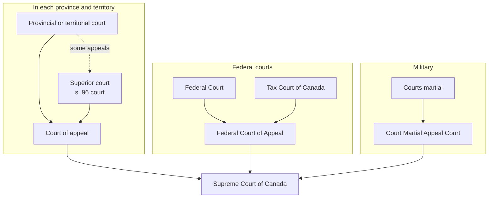

## In short

Canada has one mostly connected court system. Each province and territory has three
levels: a **provincial (or territorial) court**, a **superior court** and a **court of
appeal**. Alongside them sit a few **federal courts** for specialized areas like
immigration and tax, plus **military courts**. Everything can end up at the **Supreme
Court of Canada**, the final court of appeal.

## The details

### The map

<tn-widget name="court-map"></tn-widget>

### Provincial and territorial courts

These courts are created by provincial or territorial laws, and the province or
territory appoints their judges. They're where most people who go to court end up. They
usually hear:

- most criminal cases (everything except the most serious offences)
- youth criminal cases
- traffic and other provincial offences, and municipal bylaw cases
- many family matters (but not divorce)
- small claims, in many provinces

There are no juries in these courts. A judge decides alone.

### Superior courts (the "section 96 courts")

Each province and territory has a **superior court**. These are called **section 96
courts** because section 96 of the Constitution Act, 1867 says their judges are
appointed by the Governor General. In practice that means the federal government
appoints and pays them, while the province creates and runs the court itself.

Superior courts have **[inherent jurisdiction](term:inherent-jurisdiction)**: they can hear any case unless a law
specifically gives it to another court. They hear:

- the most serious criminal cases, such as murder, often with a jury
- major civil lawsuits
- divorce
- some appeals from provincial courts
- judicial review of provincial government decisions

Some provinces have **[unified family courts](term:unified-family-court)**, where superior court judges handle all
family matters in one place.

### Courts of appeal

Each province and territory has a **court of appeal**. It doesn't hold trials or hear
witnesses. It reviews the decisions of the lower courts for legal errors, usually with a
panel of three judges. For most cases, this is the last stop: only a small number go on
to the Supreme Court.

### The names differ by province

The levels are the same everywhere, but the names aren't. Two examples:

| Level | Ontario | Quebec |
|---|---|---|
| Provincial court | Ontario Court of Justice | Court of Québec |
| Superior court | Superior Court of Justice | Superior Court |
| Court of appeal | Court of Appeal for Ontario | Court of Appeal of Quebec |

Some provinces call their superior court the **[Court of King's Bench](term:court-of-kings-bench)** (Alberta, for
example). **Nunavut** is unusual: the [Nunavut Court of Justice](term:nunavut-court-of-justice) is a single-level trial
court that combines the superior and territorial courts, so one judge can hear any case.
See each [province page](/provinces) for local names.

### The federal courts

[Section 101](doc:constitution-act-1867/s101) of the Constitution Act, 1867 lets Parliament create a general court of
appeal for Canada (the Supreme Court) and other courts to better administer federal
laws. Using that power, Parliament created:

| Court | What it handles |
|---|---|
| **Federal Court** | Areas Parliament assigns to it, such as immigration and refugee decisions, patents and trademarks, maritime law, and reviews of decisions by federal boards and tribunals |
| **Federal Court of Appeal** | Appeals from the Federal Court and the Tax Court, and reviews of some federal tribunals |
| **[Tax Court of Canada](term:tax-court-of-canada)** | Disputes between taxpayers and the federal government about federal taxes, such as income tax and GST |

These courts deal only with matters under federal law. Most federal law, including the
[Criminal Code](term:criminal-code), is still applied every day by the provincial courts.

### Military courts

Members of the Canadian Armed Forces are subject to a separate military justice system
under the *National Defence Act*. Trials happen at **[courts martial](term:court-martial)**. Appeals go to the
**Court Martial Appeal Court of Canada**, and from there to the Supreme Court.

### The Supreme Court of Canada

The top of the system. It hears appeals from the provincial and territorial courts of
appeal, the Federal Court of Appeal and the Court Martial Appeal Court. In most cases a
party first needs the Court's permission (**[leave to appeal](term:leave-to-appeal)**). Its decisions bind every
other court in Canada. [More on the Supreme Court](org:supreme-court).

### Tribunals: not courts, but close

Many disputes never reach a court at all. **Administrative tribunals** are specialized
bodies set up by laws to decide particular kinds of disputes: for example, refugee
claims, landlord–tenant disputes, human rights complaints and workplace injury claims.
They're less formal than courts. If someone thinks a tribunal got it wrong, they can
usually ask a court to review the decision.

## Sources

- [Canada's Court System: How the courts are organized](https://www.justice.gc.ca/eng/csj-sjc/ccs-ajc/02.html) (Department of Justice)
- [The judicial structure](https://www.justice.gc.ca/eng/csj-sjc/just/07.html) (Department of Justice)
- [Constitution Act, 1867](https://laws-lois.justice.gc.ca/eng/const/page-1.html): s. 92(14) (provinces run the administration of justice), s. 96 (superior court judges appointed by the Governor General), s. 101 (Parliament may create a general court of appeal and other courts)
- [Federal Court](https://www.fct-cf.ca/en/home), [Federal Court of Appeal](https://www.fca-caf.ca/en/home), [Tax Court of Canada](https://www.tcc-cci.gc.ca/en/home), [Court Martial Appeal Court of Canada](https://www.cmac-cacm.ca/en/home)
- [Supreme Court of Canada: judicial work](https://www.scc-csc.ca/about-apropos/work-travail/judicial-judiciaire/)
