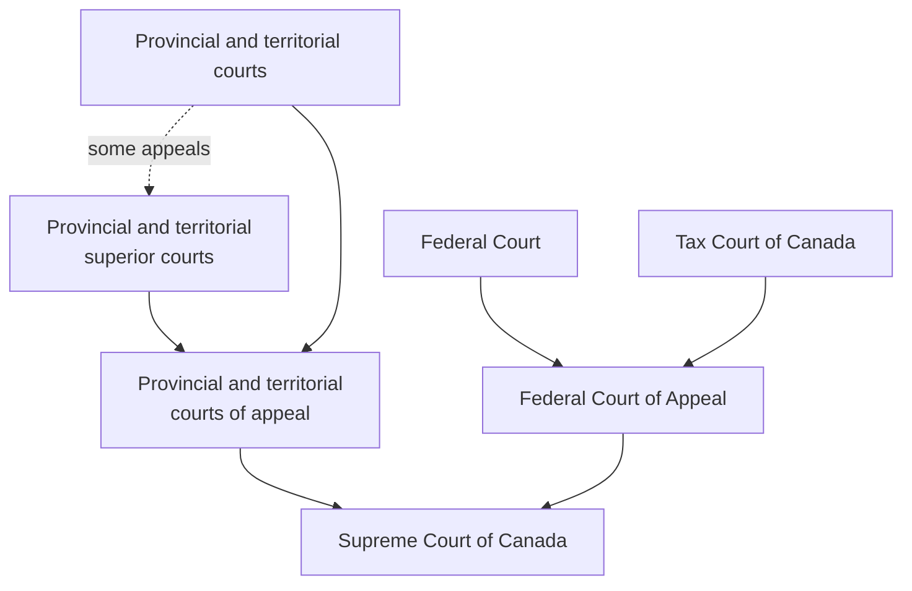

## TL;DR

Canadian law comes from four places: the **Constitution**, laws passed by Parliament and
the provincial legislatures (**statutes**), rules made under those laws
(**regulations**), and **court decisions**. Most of Canada uses the English **common
law** tradition, but Quebec uses a French-style **civil code** for private matters like
contracts and property. Criminal law is written by Parliament for the whole country, but
it's mostly enforced and prosecuted by the provinces. The courts form one connected
system with the **Supreme Court of Canada** at the top. Judges are independent of
government, and they can declare a law invalid if it breaks the Constitution.

## Core

### Where law comes from

Think of Canadian law as layers. Each layer has to fit inside the one above it.

| Layer | What it is | Who makes it |
|---|---|---|
| **The Constitution** | The supreme law. Any law that conflicts with it has no force. | Written texts (mainly the Constitution Acts of 1867 and 1982) plus unwritten conventions and principles |
| **Statutes** (also called Acts) | Laws passed by an elected legislature | Parliament, or a provincial or territorial legislature |
| **Regulations** | Detailed rules made under a statute, which must stay within what the statute allows | Usually cabinet or a minister, using power the statute gives them |
| **Case law** | The rules that come out of court decisions | Judges |

Case law does two jobs. First, judges **interpret** the Constitution, statutes and
regulations, and their interpretations guide later cases. Second, in most of Canada,
some areas of law were never fully written down by a legislature. Judges built them up
case by case over centuries. That body of judge-made law is called the **common law**.

### Two legal traditions: bijuralism

Canada is **bijural**: it has two legal traditions side by side.

- **Common law**, from England, applies in nine provinces and the three territories. Its
  core idea is **precedent**: courts follow earlier decisions on similar facts.
- **Civil law**, from the French tradition, applies to **private law** in Quebec. Private
  law covers relationships between people: contracts, property, family, inheritance,
  and liability when you harm someone. In Quebec its starting point is a single
  organized code, the **Civil Code of Québec**.

Public law, such as criminal law and constitutional law, works the same way everywhere,
including in Quebec. Federal laws are written so they work in both traditions.
[More on common law and civil law](/learn/law/common-law-and-civil-law).

### Who makes criminal law, and who enforces it

The Constitution splits criminal justice between the two orders of government (see
[Federalism](/learn/federalism)):

- **Parliament** makes criminal law for the whole country (s. 91(27) of the
  Constitution Act, 1867). The main criminal law is the **Criminal Code**, so a crime is
  the same crime in every province.
- **The provinces** run the "administration of justice" (s. 92(14)). They set up most
  courts, run most police forces, and employ most of the prosecutors who bring cases
  under the Criminal Code.

So a theft in Halifax and a theft in Vancouver break the same federal law, but they're
prosecuted by different provincial prosecution services.
[More on criminal law](/learn/law/criminal-law).

### How the courts are organized

Canada doesn't have two separate court systems (federal and provincial) the way some
countries do. It has one largely integrated system, and almost everything can end up at
the Supreme Court of Canada.

- **Provincial and territorial courts** handle the most cases: most criminal charges,
  youth cases, traffic offences, many family matters and (in many provinces) small
  claims.
- **Superior courts** hear the most serious criminal and civil cases and some appeals.
  The province runs them, but their judges are appointed and paid by the federal
  government.
- **Courts of appeal** in each province and territory review decisions from the trial
  courts.
- **Federal courts** handle specific areas Parliament gives them, such as immigration
  decisions, intellectual property and tax.
- **The Supreme Court of Canada** is the final court of appeal for the whole country.

[See the full court map](/learn/law/courts) and
[how a case reaches the Supreme Court](/learn/law/supreme-court).

### Judicial independence

Judges must decide cases based only on the facts and the law, free from pressure by
government, politicians or anyone else. This is called **judicial independence**, and
it rests on three supports:

1. **Security of tenure:** judges can't be fired for unpopular rulings. Federally
   appointed judges serve until age 75 and can be removed only for serious reasons,
   after an independent inquiry.
2. **Financial security:** governments can't punish or reward judges through their pay.
3. **Administrative independence:** courts, not governments, decide which judge hears
   which case.

Judges in Canada are **appointed**, not elected. [More on how judges are chosen](/learn/law/judges).

### Judicial review: courts can strike down laws

Because the Constitution is the supreme law (s. 52 of the Constitution Act, 1982), a
court can rule that a law that conflicts with it is **of no force or effect**. This is
called **judicial review**. A law can fail in two main ways:

- **It's outside that government's powers.** For example, a province passing a law that
  is really criminal law, which only Parliament can make.
- **It violates a protected right,** such as a right in the
  [Charter of Rights and Freedoms](/learn/charter), and the limit can't be justified.

Courts don't strike down laws on their own initiative. Someone has to bring a case, or a
government has to ask the court for its opinion (a **reference**). Legislatures often
respond by passing a new version of the law that fixes the problem.

> **Note:** Courts also review the decisions of government officials and tribunals (for
> example, an immigration officer's decision) to check they followed the law and acted
> fairly. That's also called judicial review, in its administrative-law sense.

### Where to go next

- [How the courts are organized](/learn/law/courts): the full map
- [Common law and civil law](/learn/law/common-law-and-civil-law): why Quebec is different
- [Criminal law: who does what](/learn/law/criminal-law): federal law, provincial enforcement
- [The Supreme Court of Canada](/learn/law/supreme-court): how a case gets there
- [Judges](/learn/law/judges): appointment and independence
- [Rights: the Charter](/learn/charter): the rights courts most often enforce against governments

## Misconceptions

**"Canada has separate federal and state courts, like the US."**
Not really. Canada has one mostly integrated system. Provincial courts apply federal
laws (including the Criminal Code) every day, and appeals from every province can reach
the Supreme Court of Canada. The federal courts are a small, specialized branch.

**"Each province has its own criminal code."**
No. Criminal law is federal, so the Criminal Code is the same across Canada. Provinces
can create **provincial offences** (traffic rules, liquor rules, and so on) with fines,
but these aren't crimes under the Criminal Code.

**"Quebec has a completely different legal system."**
Only for private law. Quebec uses the Civil Code for things like contracts, property and
family law. Criminal law and constitutional law in Quebec are the same as everywhere
else.

**"Judges in Canada are elected."**
No Canadian judges are elected. Federal or provincial governments appoint them, and they
hold office until retirement so they can rule without fear of losing their jobs.

**"Only the Supreme Court can strike down a law."**
Other courts can also rule that a law is unconstitutional, though usually only in the
case in front of them. The Supreme Court's rulings matter most because they bind every
other court in the country.

## Sources

- [About Canada's System of Justice](https://www.justice.gc.ca/eng/csj-sjc/just/index.html) (Department of Justice), including [the judicial structure](https://www.justice.gc.ca/eng/csj-sjc/just/07.html)
- [Canada's Court System: How the courts are organized](https://www.justice.gc.ca/eng/csj-sjc/ccs-ajc/02.html) and [The Judiciary](https://www.justice.gc.ca/eng/csj-sjc/ccs-ajc/05.html) (Department of Justice)
- [Constitution Act, 1867](https://laws-lois.justice.gc.ca/eng/const/page-1.html): s. 91(27) (criminal law), s. 92(14) (administration of justice), s. 96 (superior court judges), s. 101 (Supreme Court and federal courts)
- [Constitution Act, 1982](https://laws-lois.justice.gc.ca/eng/const/page-12.html): s. 52 (the Constitution is the supreme law)
- [Criminal Code](https://laws-lois.justice.gc.ca/eng/acts/C-46/)
- [Supreme Court of Canada: judicial work](https://www.scc-csc.ca/about-apropos/work-travail/judicial-judiciaire/)
