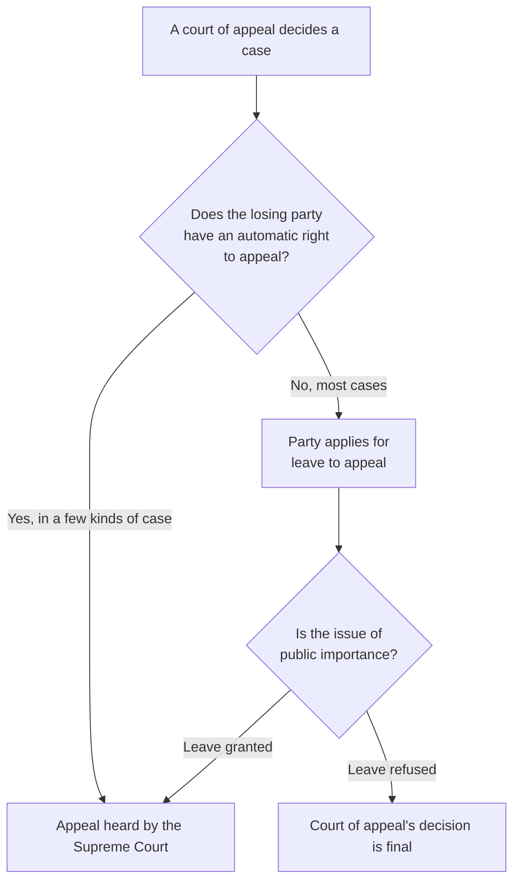

## In short

The **Supreme Court of Canada** is the country's final court of appeal. It has **nine
judges**, and by law at least **three must come from Quebec**. In most cases you need the
Court's permission to appeal, called **[leave to appeal](/glossary#leave-to-appeal)**, and it grants that only for
issues of public importance. Governments can also ask it for an opinion on a legal
question, called a **[reference](/glossary#reference)**. That's how it ruled on whether Quebec could leave
Canada.

## The details

### A short history

- **1875:** Parliament created the Supreme Court, using its power under section 101 of
  the Constitution Act, 1867.
- **Until 1949,** it wasn't actually the last word. Cases could still be appealed to the
  **Judicial Committee of the Privy Council** in London. Appeals in criminal cases to
  London ended in 1933, and all remaining appeals ended in 1949.
- **Since 1949,** the Supreme Court has been Canada's final court of appeal.

> [!NOTE]
> A well-known example of the old system: in the **Persons Case** (1929), the Privy
> Council overturned the Supreme Court and ruled that women were "persons" who could be
> appointed to the Senate.

### Who sits on it

The *Supreme Court Act* sets the Court's makeup:

- **Nine judges:** the **Chief Justice of Canada** and eight others, called **[puisne](/glossary#puisne-judges)**
  (pronounced "puny") judges (s. 4(1)).
- **Who qualifies:** a current or former judge of a provincial superior court, or a
  lawyer with at least 10 years at the bar of a province (s. 5).
- **Quebec seats:** at least three judges must come from Quebec's Court of Appeal, its
  Superior Court, or the Quebec bar (s. 6). This makes sure the Court always has judges
  trained in Quebec's civil law. See [Common law and civil law](/learn/law/common-law-and-civil-law).
- **Retirement:** judges must retire at 75 (s. 9(2)).

By custom, not law, the other six seats are usually shared out regionally: three from
Ontario, two from the western provinces or the North, and one from Atlantic Canada.
<!-- check: confirm this is described as a convention/custom by an official source -->

In 2014, the Court ruled that its own makeup, including the Quebec seats, is protected by
the Constitution. Parliament can't change it alone. Changes would need the agreement of
Parliament and every province (*Reference re Supreme Court Act, ss. 5 and 6*, 2014).

Judges are appointed by the Governor General on the Prime Minister's choice. See
[Judges](/learn/law/judges) for how candidates are found.

### How a case gets there

The Supreme Court doesn't hold trials. It hears appeals from the provincial and
territorial courts of appeal, the Federal Court of Appeal and the Court Martial Appeal
Court.

- **Leave to appeal.** For most cases, a panel of the Court first decides whether to hear
  the appeal at all. It grants leave when a case raises an issue of **public importance**
  (s. 40(1)), for example a major constitutional question, or when courts of appeal in
  different provinces disagree. The Court usually doesn't give reasons for granting or
  refusing leave. Only a small share of applications are granted.
  <!-- check: add an "As of 2026" figure for applications and grant rate from the SCC's Year in Review statistics -->
- **Appeals as of right.** In a few situations, no permission is needed. One example is
  certain criminal cases where a judge of the court of appeal dissented on a point of
  law.

Appeals are heard by at least five judges, and most often by seven or nine. There are no
witnesses or juries. The judges read written arguments, hear lawyers argue, and usually
issue written reasons, sometimes months later. Hearings can be in English or French, and
judgments are published in both.

### References: answering governments' questions

Normally a court only decides real disputes between parties. A **reference** is the
exception: a government asks a court for its opinion on a legal question.

- The **federal cabinet** can refer important questions of law or fact directly to the
  Supreme Court, for example about the meaning of the Constitution or whether a law is
  constitutional (s. 53 of the *Supreme Court Act*).
- **Provincial governments** can't go straight to the Supreme Court. They refer
  questions to their own court of appeal, and its opinion can then be appealed to the
  Supreme Court without needing leave.

Some major references:

| Year | Reference | The question, roughly |
|---|---|---|
| 1981 | Patriation Reference | Could Ottawa ask the UK to change Canada's Constitution without the provinces' consent? See [Patriation](/learn/constitution/patriation-1982). |
| 1998 | **Secession Reference** | Could Quebec leave Canada on its own? The Court said no, not unilaterally under the Constitution. But if a clear majority of Quebecers voted for secession on a clear question, the rest of Canada would have a duty to negotiate. |
| 2004 | Same-Sex Marriage Reference | Could Parliament define marriage to include same-sex couples? The Court said yes. |
| 2014 | Senate Reform Reference | Could Parliament alone create Senate elections or term limits? The Court said no; that would need provincial consent. |

The Secession Reference is also summarized on the
[landmark cases](/learn/charter/landmark-cases) page.

Strictly speaking, a reference opinion is advisory. In practice, governments have always
treated them as binding.

### Why its decisions matter so much

Every other court in Canada must follow the Supreme Court's decisions. When it rules
that a law is unconstitutional, that ruling applies across the country. This is how
the Court shapes the [Charter](/learn/charter): most of what the Charter means in
practice comes from its decisions.

## Sources

- [Supreme Court Act](https://laws-lois.justice.gc.ca/eng/acts/S-26/FullText.html): s. 4(1) (nine judges), s. 5 (qualifications), s. 6 (three from Quebec), s. 9(2) (retirement at 75), s. 40(1) (leave to appeal), s. 53 (references)
- [Supreme Court of Canada: judicial work](https://www.scc-csc.ca/about-apropos/work-travail/judicial-judiciaire/): leave to appeal, appeals as of right, references, panel sizes, bilingualism
- [Constitution Act, 1867](https://laws-lois.justice.gc.ca/eng/const/page-1.html): s. 101 (power to create a general court of appeal)
- [Reference re Secession of Quebec, [1998] 2 S.C.R. 217](https://decisions.scc-csc.ca/scc-csc/scc-csc/en/item/1643/index.do)
- [The judicial structure](https://www.justice.gc.ca/eng/csj-sjc/just/07.html) (Department of Justice)
