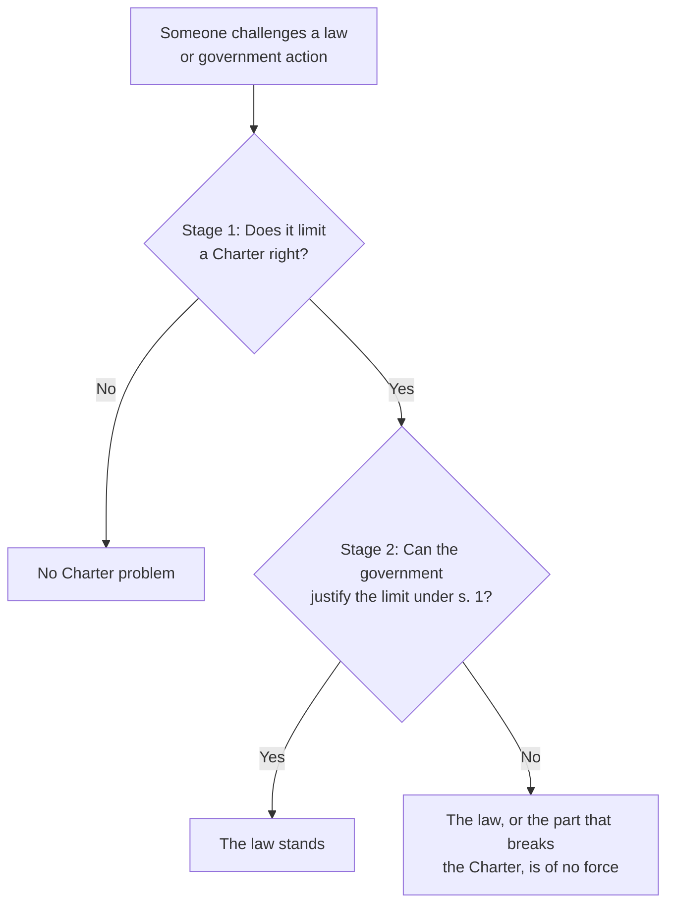

## In short

Section 1 of the Charter says rights can be limited, but only by limits that are
**reasonable**, **prescribed by law**, and **demonstrably justified in a free and democratic
society**. In [*R. v. Oakes*](case:r-v-oakes) (1986), the Supreme Court turned those words into a test.
The government must show that the law has an important purpose and that its way of
achieving that purpose is proportionate. If it can't, the law is struck down.

## The details

### The words

Section 1 reads:

> The Canadian Charter of Rights and Freedoms guarantees the rights and freedoms set out
> in it subject only to such reasonable limits prescribed by law as can be demonstrably
> justified in a free and democratic society.

So section 1 does two things at once. It **guarantees** the rights, and it says they
can be **limited**, but only in a narrow way.

### Two stages in every Charter case

- At **stage 1**, the person challenging the law has to show a right has been limited.
- At **stage 2**, the burden shifts to the **government**. It has to prove the limit is
  justified, on a balance of probabilities (more likely than not), usually with evidence.

### What "prescribed by law" means

A limit has to have a legal basis: a statute, a regulation, a binding and accessible
government policy, or a [common-law](term:common-law) rule. And it can't be so vague that people can't
tell what's allowed. A police officer acting on a whim, with no legal authority, can't
rely on section 1.

### The Oakes test

**The case.** David Oakes was charged with possessing narcotics for the purpose of
trafficking. Under the *Narcotic Control Act*, once the prosecution proved he
possessed drugs, the law presumed he intended to sell them unless he proved otherwise.
That put a burden on the accused, which conflicted with the **[presumption of
innocence](term:presumption-of-innocence)** ([s. 11(d)](doc:charter/s11)).

The Supreme Court agreed it limited his right, then asked whether the limit was
justified under section 1. To answer, it set out a test that courts still use:

| Step | The question | In plain terms |
|---|---|---|
| 1. **Pressing and substantial objective** | Is the law's purpose important enough to justify limiting a right? | Is this about a real, serious problem? |
| 2a. **Rational connection** | Is the limit logically linked to that purpose? | Does the law actually help with the problem? |
| 2b. **[Minimal impairment](term:minimal-impairment)** | Does the law limit the right as little as reasonably possible? | Is there a clearly less harmful way that would work just as well? |
| 2c. **Proportionality of effects** | Do the law's benefits outweigh its harmful effects on the right? | Is the cost to rights worth what we get? |

The government must pass **every** step. In *Oakes*, the goal of fighting drug
trafficking was important. But the law failed the rational connection step: possessing a
small amount of a drug doesn't logically point to an intent to traffic. So the
presumption was struck down.

### How it plays out in practice

- **Most cases are decided at "minimal impairment" or the final balancing.** Courts rarely
  find that a government's goal isn't important, and the rational connection step is
  not hard to meet.
- **Courts give governments some room.** A law doesn't have to be the perfect solution.
  It has to fall within a range of reasonable options. Courts tend to give more room on
  complex social and economic questions, and less where criminal law or core rights are
  at stake.
- **Saving money alone usually isn't enough.** Cost or administrative convenience on its
  own has traditionally not counted as a pressing and substantial objective, though the
  Court has accepted a genuine financial crisis in exceptional circumstances.

### Examples

| Case | Right limited | Outcome under s. 1 |
|---|---|---|
| *R. v. Oakes* (1986) | Presumption of innocence (s. 11(d)) | Not justified: struck down |
| *R. v. Keegstra* (1990) | Freedom of expression ([s. 2(b)](doc:charter/s2)), by the criminal ban on wilfully promoting hatred | Justified: upheld |
| [*Carter v. Canada*](case:carter-v-canada) (2015) | Life, liberty and security of the person ([s. 7](doc:charter/s7)), by the total ban on assisted dying | Not justified: struck down. See [Landmark cases](/learn/charter/landmark-cases). |

### Section 1 vs. section 33

Section 1 is about **justifying** a limit in court. The government has to convince a judge.
Section 33, the [notwithstanding clause](doc:charter/s33), is
different: a legislature declares that a law operates despite certain rights, and courts
can't strike it down on those grounds for up to five years. No justification to a court
is required.

## Sources

- [Constitution Act, 1982 (Charter)](https://laws-lois.justice.gc.ca/eng/const/page-12.html): s. 1, s. 11(d)
- [Charterpedia: section 1](https://www.justice.gc.ca/eng/csj-sjc/rfc-dlc/ccrf-ccdl/check/art1.html) (Department of Justice): the Oakes test, the burden on government, "prescribed by law", deference
- [R. v. Oakes, [1986] 1 S.C.R. 103](https://decisions.scc-csc.ca/scc-csc/scc-csc/en/item/117/index.do)
- [Carter v. Canada (Attorney General), 2015 SCC 5](https://decisions.scc-csc.ca/scc-csc/scc-csc/en/item/14637/index.do)
