## TL;DR

**Indigenous peoples** governed themselves on this land long before Canada existed, and
many still see their relationship with Canada as one between nations. The Constitution
recognizes three groups: **First Nations, Inuit and Métis**. Their relationship with the
Crown rests on **treaties** (some from the 1700s, some signed in the last few decades)
and on **section 35** of the Constitution Act, 1982, which recognizes and affirms
existing **Aboriginal and treaty rights**. Ottawa has special constitutional
responsibility here, mostly exercised for over a century through the **Indian Act**, a
law many people on all sides want replaced. Today, courts, modern treaties and
self-government agreements are reshaping the relationship. That's why this is a live
constitutional topic, not just history.

## Core

### Who we're talking about

**Indigenous peoples** is the collective name for the original peoples of North America
and their descendants. In Canada, the Constitution recognizes three distinct groups,
each with its own histories, languages and ways of governing:

| Group | Who | Where, mostly |
|---|---|---|
| **First Nations** | Many distinct nations, such as the Cree, Anishinaabe, Haudenosaunee, Mi'kmaq, Haida and Dene | Across the country |
| **Inuit** (one person is an *Inuk*) | The Indigenous people of the Arctic | Inuit Nunangat: Nunavut, Nunavik (northern Quebec), Nunatsiavut (Labrador) and the Inuvialuit region (Northwest Territories) |
| **Métis** | A distinct people who emerged from relationships between First Nations and European fur traders, with their own culture, language (Michif) and nationhood | Historically centred on the Prairies and the Red River area, and elsewhere |

> **As of 2026:** The most recent census ({{indigenous.census-year}}) counted about {{indigenous.rounded}} Indigenous
> people in Canada, {{indigenous.share}} of the population: roughly {{indigenous.first-nations.rounded}} First Nations people,
> {{indigenous.metis.rounded}} Métis and {{indigenous.inuit.rounded}} Inuit.

**A note on words.** The Constitution Act, 1982 uses **"Aboriginal"** (written
"aboriginal" in the legal text), because that was the usual term in 1982. Section 35(2)
says the "aboriginal peoples of Canada" include the **"Indian, Inuit and Métis
peoples."** Since roughly the mid-2010s, **"Indigenous"** has become the common term in
government and everyday use, partly because it matches international usage, such as
the UN Declaration on the Rights of Indigenous Peoples. You'll still see "Aboriginal" in
law and court decisions, and **"Indian"** remains a *legal* term in the Indian Act and
the 1867 Constitution. In everyday speech, most people say "First Nations" instead.
Where possible, the best practice is to use a nation's own name: *Mi'kmaq*,
*Tsilhqot'in*, *Inuit*.

### Nations before Canada

Before Europeans arrived, Indigenous nations had their own laws, territories, economies
and diplomacy. The Haudenosaunee Confederacy's Great Law of Peace, the potlatch systems
of the Pacific coast and the clan systems of many nations are all forms of government.
Many still operate today, sometimes alongside the governments created under Canadian
law.

Early relations with the British Crown were largely **nation to nation**: alliances,
trade and peace treaties. That history matters because it shapes how Indigenous peoples
read their treaties today.

### The legal framework, in layers

```mermaid
flowchart TD
    N[Indigenous nations<br/>own laws and territories] --> RP[Royal Proclamation, 1763<br/>only the Crown can acquire<br/>Indigenous land, by agreement]
    RP --> T[Treaties<br/>1700s to today]
    C67[Constitution Act, 1867<br/>s. 91&#40;24&#41;: federal power over<br/>Indians and lands reserved for them] --> IA[Indian Act, 1876]
    T --> S35[Constitution Act, 1982<br/>s. 35: Aboriginal and treaty rights<br/>recognized and affirmed]
    S35 --> CT[Courts define the rights:<br/>Sparrow, Delgamuukw, Haida,<br/>Tsilhqot'in, Daniels]
    S35 --> MT[Modern treaties and<br/>self-government agreements]
```

1. **The [Royal Proclamation of 1763](term:royal-proclamation-of-1763).** After Britain took control of New France, King
   George III declared that Indigenous lands could be acquired only by the Crown, through
   public agreement with the nation concerned. This set up the treaty process. The
   Charter still mentions it today (s. 25).
2. **Treaties.** Between 1701 and 1923, the Crown signed dozens of historic treaties,
   from the Peace and Friendship Treaties in the Maritimes to the 11 Numbered Treaties
   across the Prairies and North. Since 1975, it has signed **[modern treaties](term:modern-treaty)** too.
   See [Treaties](/learn/indigenous/treaties).
3. **Section 91(24) of the Constitution Act, 1867** gives the *federal* Parliament power
   over "Indians, and Lands reserved for the Indians." That's why Indigenous relations
   are mainly a federal responsibility (see [Federalism](/learn/federalism)). Courts
   have held that this covers Inuit (1939) and Métis and non-status Indians (2016).
4. **The Indian Act (1876)** is the main law Parliament passed under that power. It
   created the legal category of "status," governs reserves and set up band councils.
   See [The Indian Act](doc:indian-act).
5. **Section 35 of the Constitution Act, 1982** recognizes and affirms "existing
   aboriginal and treaty rights." Because these rights are in the Constitution, ordinary
   laws can't simply override them. See [Section 35](doc:constitution-act-1982/s35).

### What courts have said

Section 35 doesn't list the rights it protects. The Supreme Court of Canada has filled
that in, case by case:

| Case | Year | What it established |
|---|---|---|
| [*Calder*](case:calder) | 1973 | Aboriginal title (rights to land) exists in Canadian law. This pushed Ottawa to start negotiating modern treaties. |
| [*Sparrow*](case:sparrow) | 1990 | Section 35 rights can be limited only if the government can justify it, and with priority given to the right |
| [*Delgamuukw*](case:delgamuukw) | 1997 | What Aboriginal title is, and that oral histories count as evidence |
| [*Haida Nation*](case:haida-nation) | 2004 | The Crown has a **duty to consult** (and sometimes accommodate) before acting in ways that could harm rights, even unproven ones |
| [*Tsilhqot'in*](case:tsilhqotin) | 2014 | First time a court declared Aboriginal title to a specific area of land |
| [*Daniels*](case:daniels) | 2016 | Métis and non-status Indians are "Indians" under s. 91(24) |

### Treaty land and unceded land

Much of Canada is covered by historic treaties. But **most of British Columbia** was
never covered by treaty, and neither were parts of Quebec, the Atlantic provinces and
Ontario. Such land is often called **unceded**: the Indigenous nations never gave it up
by treaty. That's why many events in Canada now open with a **land acknowledgement**,
and why land claims and modern treaties are so active in BC.

### The hard history

For much of the 19th and 20th centuries, federal policy aimed at **assimilation**:
absorbing Indigenous peoples into settler society. The clearest example is the
**[residential school](term:residential-schools)** system. More than 150,000 First Nations, Inuit and Métis children
were sent to these church-run, government-funded schools, many by force, between the
1800s and the 1990s. The **[Truth and Reconciliation Commission](org:truth-and-reconciliation-commission) (TRC)** documented this
history and in 2015 issued **94 Calls to Action**. Its work is a large part of why
"reconciliation" is now a central idea in Canadian public life.

### Where things are heading

Three trends shape the relationship today:

- **Self-government.** Since 1995, Ottawa has recognized the inherent right of
  self-government as a s. 35 right. Some nations have negotiated agreements that replace
  the Indian Act with their own laws. See [Self-government](/learn/indigenous/self-government).
- **UNDRIP.** In 2021, Parliament passed the [*United Nations Declaration on the Rights of
  Indigenous Peoples Act*](doc:undrip-act), which commits the federal government to make its laws
  consistent with the Declaration, working with Indigenous peoples.
- **Courts and negotiation.** Many questions about land, resources and rights are still
  being settled, either in court or at the negotiating table.

**People disagree** about how far and how fast this should go. Some see the Indian Act,
treaties and the duty to consult as the start of a real nation-to-nation partnership.
Others worry about legal uncertainty for resource projects. Many Indigenous people say
progress has been too slow, and some question whether Canadian law should be the
framework at all. This page describes the system, not which view is right.

## Misconceptions

**"Aboriginal rights were created by the Constitution in 1982."**
No. Section 35 *recognizes and affirms* rights that already existed, many of them rooted
in Indigenous peoples' presence on the land before Europeans arrived. It didn't invent
them.

**"Treaties are historical documents with no force today."**
Treaty rights are protected by s. 35 of the Constitution. Governments are legally bound
by them, and courts enforce them.

**"Métis just means anyone with mixed First Nations and European ancestry."**
The Métis are a distinct people with their own history, culture and language. Mixed
ancestry alone doesn't make someone Métis. Exactly who belongs is a question Métis
governments and courts still work through.

**"Indigenous people don't pay taxes."**
Most do. The Indian Act exempts only certain property of *status* First Nations people
located *on a reserve*, such as income earned there. Métis and Inuit have no such
exemption under the Indian Act.

**"The duty to consult gives Indigenous nations a veto over any project."**
Not as the courts have described it. The Crown must consult in good faith and, where
appropriate, accommodate concerns. But in most cases, the law doesn't require consent.
Proven Aboriginal title is the main exception: there, the Crown needs consent or must
meet a strict justification test.

## Sources

- [Constitution Act, 1867](https://laws-lois.justice.gc.ca/eng/const/page-1.html): s. 91(24) ("Indians, and Lands reserved for the Indians")
- [Constitution Act, 1982](https://laws-lois.justice.gc.ca/eng/const/page-12.html): s. 25 (Charter doesn't reduce Aboriginal rights; mentions the Royal Proclamation of 1763), s. 35 (Aboriginal and treaty rights)
- [Indigenous peoples and communities](https://www.rcaanc-cirnac.gc.ca/eng/1100100013785/1529102490303) (Crown-Indigenous Relations and Northern Affairs Canada)
- [About treaties](https://www.rcaanc-cirnac.gc.ca/eng/1100100028574/1529354437231) (CIRNAC)
- [Indian Act](https://laws-lois.justice.gc.ca/eng/acts/I-5/) (Justice Laws): s. 87 (tax exemption)
- [Information on the tax exemption under section 87 of the Indian Act](https://www.canada.ca/en/revenue-agency/services/indigenous-peoples/information-indians.html) (Canada Revenue Agency)
- [United Nations Declaration on the Rights of Indigenous Peoples Act](https://laws-lois.justice.gc.ca/eng/acts/U-2.2/) (Justice Laws)
- [2021 Census: Indigenous population](https://www150.statcan.gc.ca/n1/daily-quotidien/220921/dq220921a-eng.htm) (Statistics Canada, *The Daily*)
- [Truth and Reconciliation Commission reports](https://nctr.ca/records/reports/) (National Centre for Truth and Reconciliation)
