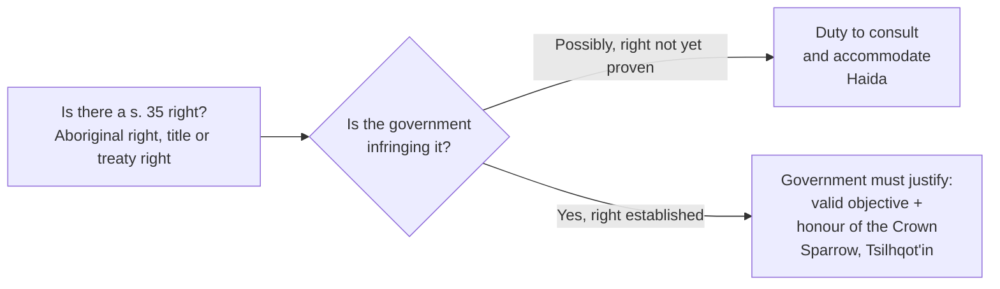

## In short

Section 35 of the Constitution Act, 1982 "recognized and affirmed" the existing
**Aboriginal and treaty rights** of the Aboriginal peoples of Canada: First Nations,
Inuit and Métis. It doesn't list those rights. The Supreme Court of Canada has defined
them over decades of cases, covering land (**[Aboriginal title](term:aboriginal-title)**), harvesting, and the
Crown's **duty to consult**. Because s. 35 is part of the Constitution, governments
can't simply pass a law to override these rights.

## The details

### What the text says

Section 35 sits in Part II of the Constitution Act, 1982, outside the Charter.

| Subsection | What it says, in plain language |
|---|---|
| **35(1)** | "The existing aboriginal and treaty rights of the aboriginal peoples of Canada are hereby recognized and affirmed." |
| **35(2)** | The "aboriginal peoples of Canada" include the **Indian, Inuit and Métis** peoples. |
| **35(3)** | Rights in **land claims agreements** (modern treaties), now or in the future, count as treaty rights. |
| **35(4)** | These rights are guaranteed equally to men and women. |

Subsections (3) and (4) were added in 1983, the only time s. 35 has been amended.
<!-- check: 1983 Constitution Amendment Proclamation added 35(3), 35(4) and s. 35.1 -->

A few words carry a lot of weight:

- **"[Existing](term:existing-section-35)"** means rights that hadn't been lawfully ended (extinguished) before 1982.
  It doesn't freeze them in their 1982 form.
- **"Recognized and affirmed"** means s. 35 didn't *create* these rights. They come from
  Indigenous peoples' prior presence on, and use of, the land, and from treaties.
- **[Aboriginal rights](term:aboriginal-rights)** come from a people's own practices and relationship to the land.
  **[Treaty rights](term:treaty-rights)** come from agreements with the Crown. A nation can have both.

Section 35 also isn't subject to the Charter's [section 1](doc:charter/s1) ("reasonable limits") or
section 33 (the [notwithstanding clause](doc:charter/s33)), since
it sits outside the Charter. Courts have built their own test for when governments may
limit these rights instead. Separately, [s. 25](doc:charter/s25) of the Charter says Charter rights can't
be read to reduce Aboriginal or treaty rights.

### The key cases

Each case below came from a real community fighting a specific dispute. Together they
make up much of the law.

**Calder (1973): title exists.** The Nisga'a Nation asked the courts to recognize that
its title to its land had never been extinguished. The Nisga'a lost on a technical
point, but six of the seven judges accepted that Aboriginal title existed in Canadian
law. They split evenly on whether it had since been extinguished. The decision led the
federal government to create a process for negotiating land claims, which eventually
produced the [Nisga'a treaty](/learn/indigenous/treaties) in 2000.

**Sparrow (1990): the first s. 35 test.** Ronald Sparrow, a Musqueam man, was charged
with fishing with a longer net than his licence allowed. The Court held that the
Musqueam had an Aboriginal right to fish for food, social and ceremonial purposes. To
limit such a right, a government must show a valid objective, such as conservation, and
must respect the honour of the Crown, including giving the right priority. Rights
couldn't be extinguished before 1982 without a "clear and plain" intention to do so.

**Delgamuukw (1997): what title means.** Brought by Gitxsan and Wet'suwet'en hereditary
chiefs over their territories in northern BC. The Court said **Aboriginal title** is a
right to the land itself, not just to particular activities on it. It also held that
**oral histories** must be given real weight as evidence. The Court ordered a new trial,
which never took place.

**Haida Nation (2004): the duty to consult.** The Haida objected to BC transferring a
forestry licence on Haida Gwaii while their title claim was unresolved. The Court held
that the Crown has a **[duty to consult](term:duty-to-consult)**, and where appropriate **accommodate**, whenever
it knows of a possible Aboriginal right or title and is considering action that could
harm it. That holds even before the right is proven in court. The duty comes from the
**[honour of the Crown](term:honour-of-the-crown)** and grows with the strength of the claim and the seriousness of
the impact. It isn't a veto. The duty belongs to the Crown, not private companies,
though some steps can be delegated to them.

**Tsilhqot'in (2014): title declared.** For the first time, the Court declared
Aboriginal title to a specific area: land in central BC. It held that title can rest on
regular use of a territory, not only on village sites. Once title is established, the
Crown needs the nation's **consent** to use the land, or must meet a strict
justification test.

**Daniels (2016): who counts under s. 91(24).** Métis and non-status Indians are
"Indians" for the purposes of [s. 91(24)](doc:constitution-act-1867/s91-24) of the Constitution Act, 1867, so they fall
under federal jurisdiction. (An earlier 1939 reference case had already decided this
for Inuit.) Daniels was about which government is responsible. It didn't grant any
particular rights.

Other important cases include *Guerin* (1984) on the Crown's [fiduciary](term:fiduciary-duty) (trust-like)
duties, *Van der Peet* (1996) on how to prove an Aboriginal right, and *Powley* (2003),
which recognized Métis harvesting rights under s. 35. <!-- check: one-line summaries of Guerin, Van der Peet, Powley -->

### How the pieces fit

### Perspectives

Many Indigenous people see s. 35 as an important but partial recognition. It brought
their rights into the Constitution, but within a framework of Crown sovereignty they
never agreed to, and it leaves courts to define rights case by case. Governments and
industry often point to the cost and uncertainty of unresolved claims. Both views help
explain why many nations prefer negotiating treaties and
[self-government](/learn/indigenous/self-government) agreements over litigation.

## Sources

- [Constitution Act, 1982](https://laws-lois.justice.gc.ca/eng/const/page-12.html): s. 25, s. 35
- [Constitution Act, 1867](https://laws-lois.justice.gc.ca/eng/const/page-1.html): s. 91(24)
- [*Calder et al. v. Attorney-General of British Columbia*, [1973] S.C.R. 313](https://decisions.scc-csc.ca/scc-csc/scc-csc/en/item/5113/index.do)
- [*R. v. Sparrow*, [1990] 1 S.C.R. 1075](https://decisions.scc-csc.ca/scc-csc/scc-csc/en/item/609/index.do)
- [*Delgamuukw v. British Columbia*, [1997] 3 S.C.R. 1010](https://decisions.scc-csc.ca/scc-csc/scc-csc/en/item/1569/index.do)
- [*Haida Nation v. British Columbia (Minister of Forests)*, 2004 SCC 73](https://decisions.scc-csc.ca/scc-csc/scc-csc/en/item/2189/index.do)
- [*Tsilhqot'in Nation v. British Columbia*, 2014 SCC 44](https://decisions.scc-csc.ca/scc-csc/scc-csc/en/item/14246/index.do)
- [*Daniels v. Canada (Indian Affairs and Northern Development)*, 2016 SCC 12](https://decisions.scc-csc.ca/scc-csc/scc-csc/en/item/15858/index.do)
