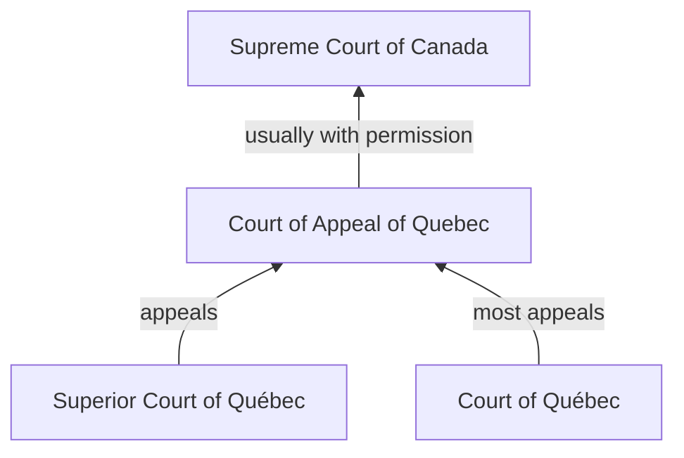

## At a glance

| | |
|---|---|
| Capital | Quebec City |
| Joined Confederation | 1867 (one of the four founding provinces) |
| Legislature | National Assembly of Québec (Assemblée nationale du Québec), one chamber |
| Seats | {{legislature.seats.quebec}} |
| The King's representative | Lieutenant Governor |
| Head of government | Premier (*premier ministre*) |

> **As of 2026:** The National Assembly has {{legislature.seats.quebec}} seats. It grew from 125 to 127 under
> the electoral map used for the October 2026 general election.

## In numbers

<tn-widget name="province-profile" data-province="quebec"></tn-widget>

## How it's governed

Quebec uses the same **parliamentary** model as the other provinces (see
[Parliament](/learn/parliament)), but much of the vocabulary is its own.

- **The National Assembly** is the elected law-making body. Voters elect one **[MNA](term:mna)**
  (member of the National Assembly, *député*) in each electoral division. Until 1968
  it was called the Legislative Assembly. That same year Quebec abolished its
  appointed upper house, the **[Legislative Council](term:legislative-council)**, making it the last province to
  drop its second chamber.
- **The Premier** leads the government and must keep the **[confidence](term:confidence)** of the
  Assembly. In French the title is *premier ministre*, the same words used for the
  Prime Minister of Canada, which can confuse readers of French news.
- **The Lieutenant Governor** represents the King, gives royal assent to bills and
  appoints the Premier, acting on the elected government's advice by convention. See
  [The Crown](/learn/crown/governor-general).

## What makes it different

Quebec is the province where the differences run deepest: in its law, its language
and its relationship with the Constitution.

### Civil law, not common law (for private law)

Every other province uses the English **[common law](term:common-law)**, where many rules come from past
court decisions. For **private law** (contracts, property, family, inheritance,
liability between people), Quebec uses **[civil law](term:civil-law)**, a tradition descended from
French law, where the core rules are written down in one big code.

- The **[Civil Code of Québec](term:civil-code-of-quebec)** came into force in 1994. It replaced the Civil Code of
  Lower Canada, which dated from 1866.
- The roots go back to the **[Quebec Act of 1774](event:quebec-act-1774)**, in which Britain restored French
  civil law to the colony after the conquest.
- **Criminal law** is federal and the same across Canada, including in Quebec. So is
  most other federal law.

Canada therefore has two legal traditions at once, called **[bijuralism](term:bijuralism)**. Federal laws
are written to work in both. See [Common law and civil law](/learn/law/common-law-and-civil-law).

The [Supreme Court Act](doc:supreme-court-act/s6) requires that at least **three of the nine judges** of the
Supreme Court of Canada come from Quebec, so that the court always has civil-law
expertise.

### French as the common language

French is Quebec's only official language. The **Charter of the French Language**,
passed in 1977 and often called **[Bill 101](term:bill-101)**, makes French the normal language of
government, work, business and public signs, and requires most children to attend
French-language schools. It was significantly expanded in 2022 (often called
[Bill 96](term:bill-96)). English-speaking Quebecers have specific constitutional rights, including
English-language schooling for eligible children and the right to use English in the
province's legislature and courts (s. 133 of the Constitution Act, 1867; [s. 23](doc:charter/s23) of
the Charter).

### Its own charter of rights

Quebec adopted its own **[Charter of Human Rights and Freedoms](term:quebec-charter-of-human-rights-and-freedoms)** in 1975, seven years
before the [Canadian Charter](doc:charter). One key difference: the Canadian Charter only limits
*governments*, but Quebec's Charter also applies between private parties, such as
an employer and an employee, or a landlord and a tenant.

### Powers others don't use

Through agreements with Ottawa, Quebec does several things itself that the federal
government handles elsewhere:

- It runs the **[Quebec Pension Plan](term:quebec-pension-plan)** instead of the Canada Pension Plan.
- It collects its own provincial income tax through **Revenu Québec**.
- It selects most of its own **economic immigrants** under the Canada–Québec Accord
  of 1991. Ottawa still handles citizenship, admissibility and security checks.

### The constitutional question

Quebec's relationship with the Constitution is unlike any other province's.

1. **1980 referendum.** Quebecers voted on whether to give their government a mandate
   to negotiate "[sovereignty-association](term:sovereignty-association)" with Canada. About 60% voted No.
2. **[1982 patriation](event:patriation).** The Constitution was brought home from Britain and the Charter
   added, with the agreement of every province **except Quebec**. The National
   Assembly never approved it. Legally, the Constitution still applies fully in
   Quebec. See [Patriation, 1982](/learn/constitution/patriation-1982).
3. **[Meech Lake](event:meech-lake-accord) (1987–1990) and [Charlottetown](event:charlottetown-accord-1992) (1992).** Two attempts to bring Quebec
   into the constitutional fold, partly by recognizing it as a "[distinct society](term:distinct-society),"
   both failed.
4. **1995 referendum.** A second vote, on sovereignty with an offer of partnership with
   Canada. No won by about 50.6% to 49.4%, the closest result in Canadian history.
5. **1998 [Secession Reference](case:secession-reference).** The Supreme Court of Canada said Quebec has no right
   to secede on its own under the Constitution or international law. But if a clear
   majority voted yes on a clear question, the rest of Canada would have a duty to
   negotiate. Parliament followed with the **Clarity Act** (2000).
6. **2006 "nation" motion.** The House of Commons passed a motion recognizing that
   "the Québécois form a nation within a united Canada." It has symbolic, not legal,
   force.

Sovereignty remains a live political question in Quebec, and people hold strong and
sincere views on all sides. This site describes the process, not who's right.

### Frequent use of the notwithstanding clause

Quebec governments have used the Charter's **[notwithstanding clause](term:notwithstanding-clause)** (section 33),
which lets a legislature shield a law from some Charter rights for five years at a
time, more than any other province. Recent examples include its [2019 secularism law](event:quebec-secularism-law-2019)
and the 2022 French-language amendments. Supporters see this as legislatures having
the last word; critics see it as weakening rights. See
[The notwithstanding clause](doc:charter/s33).

## Courts

| Court | What it does |
|---|---|
| **Court of Appeal of Quebec** (*Cour d'appel du Québec*) | The province's highest court. Hears appeals in civil and criminal cases. |
| **Superior Court of Québec** (*Cour supérieure du Québec*) | The **superior court** (trial court of general jurisdiction). Hears larger civil cases, divorces, and serious criminal trials with a jury. |
| **Court of Québec** (*Cour du Québec*) | The provincial court. Hears most criminal cases, youth cases, smaller civil claims (including small claims), and appeals from some administrative bodies. |
| **Municipal courts** | Local courts for bylaw offences, many traffic tickets and some minor criminal matters. |

For how the levels fit together across Canada, see [the court structure](/learn/law/courts).

## Local government

Quebec has more than a thousand municipalities, created by the province. Above them
sit **[regional county municipalities](term:regional-county-municipality)** (*MRCs*), which group neighbouring
municipalities for land-use planning and shared services. The Montreal and Quebec
City areas each also have a **metropolitan community** for region-wide planning.

In the north, regional bodies created under modern treaties play a large role, such
as the **Kativik Regional Government** in Nunavik (an Inuit region) and the **Cree
Nation Government** in Eeyou Istchee. See
[Indigenous peoples and the Crown](/learn/indigenous).

## Sources

- [Assemblée nationale du Québec: ABC of the Assembly](https://www.assnat.qc.ca/en/abc-assemblee/index.html)
- [Electoral map: final boundaries](https://www.electionsquebec.qc.ca/en/electoral-maps/review-of-quebecs-electoral-map/electoral-map-final-boundaries/) (Elections Québec): increase from 125 to 127 divisions
- [Québec at a glance](https://www.quebec.ca/en/government/quebec-at-a-glance) (Gouvernement du Québec)
- [Civil Code of Québec](https://www.legisquebec.gouv.qc.ca/en/document/cs/CCQ-1991) <!-- unverified link: blocked (403) to automated check 2026-11-13 -->
- [Charter of the French Language](https://www.legisquebec.gouv.qc.ca/en/document/cs/C-11) <!-- unverified link: blocked (403) to automated check 2026-11-13 -->
- [Charter of Human Rights and Freedoms (Quebec)](https://www.legisquebec.gouv.qc.ca/en/document/cs/C-12) <!-- unverified link: blocked (403) to automated check 2026-11-13 -->
- [Canada–Québec Accord relating to Immigration and Temporary Admission of Aliens](https://www.canada.ca/en/immigration-refugees-citizenship/corporate/mandate/policies-operational-instructions-agreements/agreements/federal-provincial-territorial/quebec/canada-quebec-accord-relating-immigration-temporary-admission-aliens.html) (signed February 5, 1991; in force April 1, 1991)
- [The Notwithstanding Clause of the Charter](https://publications.gc.ca/collections/Collection-R/LoPBdP/BP/bp194-e.htm) (Library of Parliament, BP-194E, revised 1997): Quebec added the clause to every law from 1982 to 1985
- [Cree Nation Government: main agreements](https://www.cngov.ca/governance-structure/legislation/agreements/) and the [Kativik Regional Government](https://www.krg.ca/en-CA/)
- [Supreme Court Act](https://laws-lois.justice.gc.ca/eng/acts/S-26/page-1.html): s. 6 (three judges from Quebec)
- [Reference re Secession of Quebec, 1998](https://decisions.scc-csc.ca/scc-csc/scc-csc/en/item/1643/index.do) (Supreme Court of Canada)
- [Clarity Act](https://laws-lois.justice.gc.ca/eng/acts/C-31.8/)
- [House of Commons Journals, November 27, 2006](https://www.ourcommons.ca/documentviewer/en/39-1/house/sitting-87/journals): the "nation within a united Canada" motion
- [Constitution Act, 1867](https://laws-lois.justice.gc.ca/eng/const/page-1.html): s. 133 (English and French in Quebec's legislature and courts)
- [The judicial structure](https://www.justice.gc.ca/eng/csj-sjc/just/07.html) (Department of Justice)
- [Court of Appeal of Quebec](https://courdappelduquebec.ca/en/) <!-- unverified link: blocked (403) to automated check 2026-11-13 -->
- [Superior Court of Québec](https://coursuperieureduquebec.ca/en/) <!-- unverified link: blocked (403) to automated check 2026-11-13 -->
- [Court of Québec](https://courduquebec.ca/en/) <!-- unverified link: blocked (403) to automated check 2026-11-13 -->
